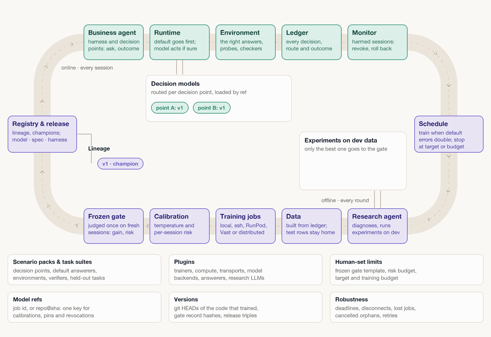

# ouroloop

English | [中文](README.zh-CN.md)

An engineering prototype of bounded recursive self-improvement (bounded RSI): it discovers useful methods from task feedback, validates and consolidates them into runnable agent applications, and lets a validated update to its own improvement policy drive the next improvement. In the first release that update is limited to the improver's two research prompts, with scoring, permissions and budgets fixed; see [design §7](docs/DESIGN.md).

**Results (2026-10-04).** Two complete activities on AutomationBench Marketing with Claude Opus 5.5, each measured on the held-out test split under a plan sealed and committed before the test tasks were run. v0.1: the evolved version raised the pass rate from **41.3% to 54.3%** (+13.0 points, 95% interval [+2.2, +26.1]). v0.2, a full activity including the research slot: 47.8% to 52.2% (+4.3 points, [−10.9, +19.6], not significant on its own); over both activities the per-task average is +8.7 points [−2.2, +20.7]. The changes were found by the framework from training failures alone, with no human choosing them, at about the same cost per attempt. The recursive part, R improving its own research prompts, is not yet shown: v0.2's research slot compared nothing because neither research policy added a change. Setup, process, costs (about $525 API-equivalent in all) and limits: [docs/RESULTS.md](docs/RESULTS.md).

The [v0.6 design](docs/DESIGN.md) connects capability discovery, validation, consolidation and recursive reuse. Users supply a task environment, goals, permissions, initial models and a budget. The first release evolves tools, middleware, skills and memory inside versioned harness packages, runs generated code through a fixed isolated API, validates task outcomes and regressions, and releases an app with the same actor. Improvement policies are also evaluated and reused through the existing research loop. The second release adds teacher-guided distillation and further training support; actor/controller separation and existing decision trainers remain supported. Tinker is a proposed training backend, not a prerequisite for the first release.

**Implemented:** decision policies and training infrastructure, the AutomationBench adapter, paired task evaluation, complete W/R releases, shared budgets and recovery, a task-improvement loop, and isolated research-policy comparison and reuse ([implementation snapshot](docs/history/V0_5_IMPLEMENTATION.md)). The first release's engineering path is now in place too: per-task diagnosis of train failures, versioned capability packages (memory, skills, hooks and tools) with a draft check before anything is frozen, package code run only in an isolated Docker worker, research campaigns on that loop with a check that an installed R1 is actually used, the `cycle` entry with its preset, and export of an installed version as a minimal app. All of it is validated offline with fixture worlds and scripted researchers; CI builds the worker image and runs the Docker isolation tests. A review on 2026-10-02 found four high-severity defects: when the core freezes no method list, a proposal could name a model backend that the control plane imports; research verdicts accepted identical or unpaired arms; and a resumed experiment ignored its frozen plan. All four are now fixed ([roadmap §3](docs/ROADMAP.md)).

**Measured:** GLM-5.3 completed one Marketing development task on 2026-09-28. On 2026-10-01 two real runs followed: one took a failed train task through failure notes, a summary proposal, a draft check with one revision, admission and a frozen experiment to a built candidate, and stopped before the gate on purpose; another, whose draft passed its check without revision, went through screening to one dev gate. The provider account ran out of balance during that comparison (19 of 20 dev attempts invalid), so the gate was inconclusive and nothing was installed. Those GLM runs were not evidence of improvement. The first measured gain came on 2026-10-04 with Claude Opus 5.5 ([results](docs/RESULTS.md)); the recursive-research gain (R improving itself) is not yet measured. Actor distillation, its Tinker backend and teacher review belong to the second release. See the [journal](docs/JOURNAL.md).

AutomationBench Marketing remains the first proving ground. The first release compares the same pinned actor before and after harness-package evolution (planned as GLM-5.3; from 2026-10-03 Claude Opus 5.5 runs first, docs/ROADMAP.md §3 step 2a), retains an effective prompt/workflow baseline, and uses published leading-model results as a separately labelled reference. Local frontier runs remain optional future work, consistent with the latest benchmark plan. In the second release, h* is re-evolved on the Qwen3.5-9B student before distillation. Teacher-assisted collection scores are reported separately from deployment scores.

Decision labels still require observed evidence or human feedback; a final reward does not label every intermediate action. The planned teacher trajectories have a separate imitation-learning purpose and do not relax this rule for decision training. Jev and existing local decision trainers remain supported.

Implementation starts with the [roadmap](docs/ROADMAP.md), [technology choices](docs/TECHNOLOGY.md), and [module specifications](docs/modules/README.md). The commands below describe existing functionality; second-release configuration (distillation, teachers, training) is marked as proposed in the design docs and refused by the readers.

## How the loop improves itself

`ouroloop bench --phase improve` runs this loop round by round on the business benchmark ([ouroloop/bench.py](ouroloop/bench.py)); a harness of your own runs the online half on every session. A round trains only what an admission passed, so a round with nothing new to learn from spends no GPU (`ouroloop plan` shows the same reading). Each `ouroloop evolve` call runs one round of the legacy decision profile (the training job, calibration, the gate, promotion) whatever the plan would say.

<p align="center"></p>

The diagram illustrates the existing decision-learning loop, not measured business improvement or the complete v0.6 architecture. The new workflow-distillation path is described in the design docs.

The first-release plan connects bounded package code evolution to the existing automatic loop: R proposes package edits from feedback; fixed code enforces isolation, permissions, budgets, evaluation and release. Updated W runs subsequent tasks, while an accepted R update must be loaded by the next actual improvement call. Distillation follows in the second release. Real harness-evolution and recursive gains remain unproven.

The existing takeover policy uses calibrated thresholds, labelled-session risk checks and runtime revocation. These controls depend on their feedback and statistical assumptions; they do not establish a 5% business-task failure bound. The benchmark profile evaluates complete task outcomes under a separately fixed protocol while preserving the existing deployment profile.

`ouroloop research` is the legacy decision profile's own round, kept as it was; the business loop's rounds run through `ouroloop bench --phase improve` and `--phase research`.

## Quick start

Python 3.11 or newer, on macOS or Linux (the agent's tools use bash; on Windows, use WSL).

```bash
python3 -m venv .venv && . .venv/bin/activate
pip install -e ".[dev]"      # the only runtime dependency is httpx
pytest -q                    # offline: no network, no models
ouroloop demo                # one research round on synthetic data, offline
```

To use Jev, put `TYPESAFE_API_KEY=...` in `.env` at the repository root (git ignores it).

```bash
ouroloop smoke                   # ask Jev one question of each type
ouroloop demo --judge jev        # let Jev make the research loop's judgments
ouroloop decide --backend jev --type noul --question "The failure is transient" --state "ConnectionResetError"
pytest -m live                   # smoke tests against the real API
```

## Run the agent

The built-in agent is minimal: an LLM with read, write, edit and bash, plus five decision points around it (`route`, `tool_gate`, `retry`, `compact`, `stop`).

```bash
pip install -e ".[anthropic]"    # for Claude; set ANTHROPIC_API_KEY
ouroloop run "fix the failing tests" --llm anthropic --judge jev
ouroloop run "..." --llm openai_compat --model qwen3 --base-url http://localhost:11434/v1
ouroloop run "..." --llm anthropic --verify "pytest -q" --small-model claude-haiku-4-5
```

- Tool calls ask for your approval (y/N) unless you pass `--yes`. Commands on the deny list (`rm -rf /`, `curl ... | sh` and the like) never run.
- `--verify` takes a command that exits 0 when the task is done. When the agent wants to stop, ouroloop runs it first and sends the output back if it fails (at most twice). The result also labels the `stop` decision.
- `--small-model` adds a cheaper tier; the `route` decision point picks the tier for each step once it acts; until then every step uses the large tier. The task outcome is a weak label for small-tier steps.
- In an interactive run, ouroloop asks at the end whether the task was done, and records the answer.
- `ouroloop hook print-settings` prints Claude Code hooks that record tool calls and their results from your normal Claude Code sessions into the ledger, without changing Claude Code's behaviour.

## Models

The research agent and `ouroloop run` work with any model:

- Claude through the official SDK: `[llm] type = "anthropic"` (default `claude-opus-5`, with prompt caching).
- Claude through headless Claude Code on a subscription login: `type = "claude_code"` (`claude -p` with no tools, in an empty directory; tool calls as structured JSON output). See docs/modules/01_POLICY_RUNTIME.md §1.
- Anything with an OpenAI-compatible API: `type = "openai_compat"` (Zhipu GLM, OpenRouter, DeepSeek, vLLM, Ollama and others), with retries on rate limits and server errors. Provider-specific request fields go in `[llm.extra]`, for example GLM's reasoning effort. See [examples/zhipu.toml](examples/zhipu.toml).
- A config's `env_file` points at a `.env` relative to the config, so keys are found from any directory.

## Research and evolution

```bash
ouroloop gate freeze --config examples/ouroloop.toml           # once, by a person: the gate every promotion goes through
ouroloop research --config examples/ouroloop.toml --rounds 3   # research rounds over the ledger
ouroloop plan --config examples/ouroloop.toml                  # what the data says, and whether a round should train
ouroloop evolve --config examples/ouroloop.toml                # train a new decision model; promote only if it passes the gate
ouroloop calibrate --config examples/ouroloop.toml             # report each point's temperature and thresholds
ouroloop models --dir examples/workspace                       # model lineage; --rollback to go back (and revoke)
ouroloop ledger --dir examples/workspace                       # decisions, label coverage and agreement per point
```

The gate template can tighten, never loosen, the 5% risk, the 30 fresh sessions each gate needs and the bootstrap. Each round's gate record, its use and its verdict are events in the ledger; `gates/` holds copies. Only what a gate record accepted can be promoted, answer or act.

About TDE: TDE is a separate project that will be released on its own. The `tde` trainer records how ouroloop trains it: as a job (`ouroloop/worker.py`) on this machine, or on a GPU host over ssh with `host = "user@box"`, in a new directory `<jobs_root>/<job id>/` there. The job publishes its run to the model store, `[store]`, and the model it yields is a ref: the job id with `type = "dir"` (a directory, on the training host when there is one), or `<repo>@<commit>` with `type = "hf"`, which commits the run once to a private Hugging Face repository. `[serving]` (formerly `[models]`) says how refs are asked: `url` (and `token_env`) for `ouroloop serve` on a host that can read the store, or in-process from the store. A model the gate accepts is deployed before it becomes the champion (`ouroloop deploy <version>` retries a failed deploy). Control plane, training, store and serving are four roles; one GPU host that holds three of them is a layout (docs/TRAINING_HOSTS.md). Without TDE, the whole pipeline runs with the built-in signature model (`type = "signature"`). To bring your own model, write a trainer plugin (`ouroloop/trainers/__init__.py`, docs/TRAINING_HOSTS.md §1): `train` runs as the job on the training machine, `backend(run, ref, options)` loads the model for serving; name it in the config as `type = "your.module"`. A `type = "your.module:YourTrainer"` trainer trains in this process and its backend is built here, outside the store and `[serving]`: for tests and demos.

To serve a model for harnesses on other machines, run the decision service where the model lives and point an `http` backend at it. Binding to anything other than localhost requires a token, because `/outcome` writes training labels into the ledger.

```bash
OUROLOOP_TOKEN=... ouroloop serve --config host.toml --host 0.0.0.0 --port 8765
```

## Task suites and prompt evolution

[evals/tasks](evals/tasks) holds 29 small coding tasks: 21 for development and 8 held out. Each task is one TOML file with a prompt, starting files, check commands, and hidden tests that are written only after the agent finishes, so the agent cannot edit them. A run scores the share of checks that pass.

```bash
ouroloop suite --validate --tasks evals/tasks               # no LLM: every task fails as given and passes with its solution
ouroloop suite --config examples/zhipu.toml                 # run the suite with the champion prompt
ouroloop research --config examples/zhipu.toml --rounds 2   # with a [suite], the research agent also improves the harness prompt
```

A prompt candidate is evaluated in steps:

- a change that only touches whitespace is rejected without running anything;
- it runs on a few development tasks first, and only if it does no worse than the champion do the champion and the candidate both run again on every task, held-out ones included, for the promotion gate;
- the research agent never sees held-out results;
- each run is recorded once per (prompt, model, task, repeat) in `harness/runs.jsonl`; recorded runs serve the first step only, and a round gates once, so re-running a prompt until it gets lucky is not possible.

The checks at the end of a task also label that run's `stop` and `route` decisions. Suite runs execute bash automatically, in a temporary directory with the deny list in force; use a container or a VM if you do not trust the model.

## AutomationBench

[AutomationBench](https://github.com/zapier/AutomationBench) simulates business workflows across 47 SaaS tools and
checks whether the agent left the world in the correct state. It is a separate runtime that ouroloop imports
lazily; clone it and point `[bench] upstream_path` at the checkout
([examples/automationbench/README.md](examples/automationbench/README.md) lists what to install).

```bash
ouroloop bench --config examples/automationbench/marketing.toml --phase smoke --checks-only   # no model called
ouroloop bench --config examples/automationbench/marketing.toml --phase smoke                 # and a few dev tasks
```

The first release's automatic loop is one command over a config with an `[improvement]` preset and a budget
([examples/automationbench/improvement.toml](examples/automationbench/improvement.toml)): it freezes the plans it is
not given, runs the starting version's baseline, a worker segment, the planned research slot and one more segment
that shows whether an installed R is used, and ends with the offline report. Interrupted, it resumes without paying
again for what is on record. Package code runs only in the isolated worker image:

```bash
docker build -f docker/worker.Dockerfile -t ouroloop-worker:py3.12 .
ouroloop bench --config examples/automationbench/improvement.toml --phase cycle
ouroloop export --config examples/automationbench/improvement.toml --to exported-marketing
```

The smoke phase reports which upstream this is, freezes the train/dev/test task groups into
`<workspace>/bench/<domain>/splits.json` before any result is looked at, checks this adapter against upstream's own
rubric entry point, service gate and tool schemas, audits that nothing grading-related reaches the agent, and then
attempts a couple of development tasks end to end. It makes no claim about capability, and a local score on the
public task set is not an official leaderboard score — the leaderboard runs a private set.

The boundaries are structural rather than a matter of care: the agent is handed the task prompt and the tool
schemas while the assertions and the seeded state live in an object it never receives, and the score comes from
the world the tools left, so a run that writes the wrong record and then reports success scores what it wrote.
The later phases run the same loop: `baseline` measures a reasonable base version. It also supports explicit
frontier arms, but the current plan uses published frontier references instead. `collect` labels completion
decisions offline, `improve` runs the worker loop with a fixed
research policy, `research` compares two research policies in isolated arms, `evaluate` runs one sealed final plan,
and `report` recomputes everything from the records on disk. They run against frozen plans — objects in the
workspace rather than settings in the config file — and a phase whose plan or model table is missing says so before
it calls a model.

## Code layout

| Path | What it holds |
|---|---|
| `ouroloop/decision.py` | decision points and specs (question, candidates, view parameters) |
| `ouroloop/policy.py` | the execution rule, threshold fitting, exploration and propensities |
| `ouroloop/ledger.py` | the ledger, raw contexts, champion specs, redaction |
| `ouroloop/runtime.py` | ties decision points, backends, default answerers and the ledger together; fixes each session's release |
| `ouroloop/release.py` | the release a session runs with: the legacy triple, and the complete W/R release with its permits, installs, recovery and revocations |
| `ouroloop/policies.py` | the registered policy targets, what may be bound to each, assembly, session pinning and candidate building |
| `ouroloop/agent/` | the minimal agent: loop, four tools, harness prompt, task suites; capability packages (`harness_package.py`) and the isolated worker that runs their code (`worker.py`, `worker_runner.py`) |
| `ouroloop/app.py` | the minimal app an exported release runs as |
| `ouroloop/points/` | built-in points `retry`, `compact`, `tool_gate`, `stop`, `route`, and the deny list |
| `ouroloop/chat.py` | a provider-neutral chat format |
| `ouroloop/providers/` | Anthropic (official SDK), OpenAI-compatible APIs, headless Claude Code, and `manual` (requests and replies as files) |
| `ouroloop/backends/` | decision backends: `mock`, `jev`, `tde`, `llm`, `http` |
| `ouroloop/research/` | question conversion, the research agent interface and default, research rounds, what a researcher may read (`context.py`), what actually ran (`inspection.py`), proposals and admission (`experiment.py`), research-policy campaigns (`campaign.py`), per-task failure diagnosis (`diagnosis.py`), draft checks and revisions (`drafts.py`) |
| `ouroloop/evolve/` | the shared contracts and object store (`contracts.py`), feedback builders, dataset building, data checks, trainers and their training jobs (worker, compute), calibration, the frozen promotion gate and its records, the paired task gate (`task_gate.py`), the execution state machine and budget book (`execution.py`), model registry, experience records |
| `ouroloop/serve.py` | the HTTP decision service |
| `ouroloop/benchmark.py` | the benchmark run contract: frozen task groups, run identity, one attempt's result |
| `ouroloop/bench.py` | the phases of `ouroloop bench`, the startup checks and the wiring one improvement activity runs through |
| `ouroloop/report.py` | the offline report: identity, task effect, costs, improvement and RSI evidence, C1 to C4 states |
| `ouroloop/adapters/` | AutomationBench (tasks, business tools, the official scorer); Claude Code hooks (an optional data source) |

## Status

The current implementation includes the v0.5 engineering loop, the first release's package-evolution loop (stages A–E of the [roadmap](docs/ROADMAP.md), validated offline with fixtures), and the real-model runs listed under Measured above (no measured gain yet). Of the four high-severity defects found on 2026-10-02, two are fixed and two are fixed before any research slot runs ([roadmap §3](docs/ROADMAP.md)). The second release (teacher adaptation, distillation, training) is specified but not implemented. Historical test results and known limitations are preserved in the [implementation snapshot](docs/history/V0_5_IMPLEMENTATION.md); measured results remain in the [journal](docs/JOURNAL.md).

The design documents are currently in Chinese: [overall design](docs/DESIGN.md), [technology choices](docs/TECHNOLOGY.md), [roadmap](docs/ROADMAP.md), [module handoff and acceptance cases](docs/modules/README.md), [research protocol](docs/RESEARCH_AGENT.md), [design review](docs/RSI_REVIEW.md), and [demo and evidence](docs/DEMO.md).

## License

MIT, see [LICENSE](LICENSE).
