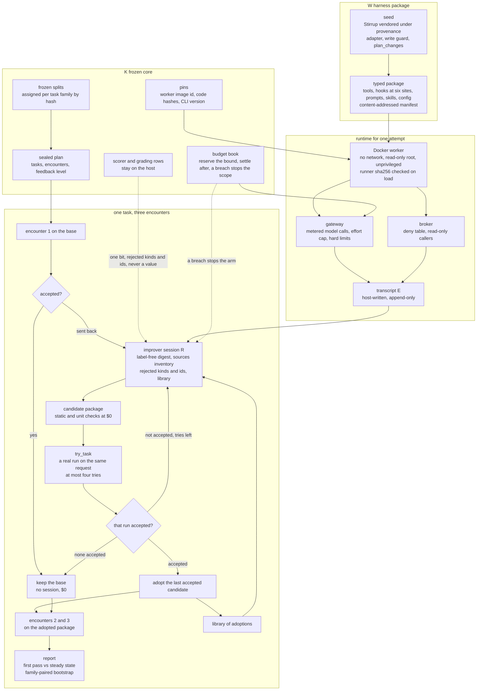

# reharness

English | [中文](README.zh-CN.md)

**An agent that gets the same request right the second time.** reharness runs a business agent on repeated requests. When a request comes back sent back, an improver reads the agent's own run of it, changes the agent's harness package — its tools, hooks, skills, prompts — and tries the change on the same request for real. Only a try that comes back accepted is adopted, and only for that request. No person picks the change, no model judges it, and the improver is never shown an answer: at most "accepted or sent back" per attempt and which check was rejected.

Built and measured on [AutomationBench](https://github.com/zapier/AutomationBench) (47 simulated SaaS tools, scored on the world state the agent leaves behind) with Claude Opus 5.5 as both the agent and the improver, on a subscription budget.

## How it works



### The loop

A sealed plan names the tasks and how many times each is met (three). Encounter 1 runs the base harness. If the request was accepted, the task is finished: no session, nothing changes, $0. If it was sent back, the improver R gets one coding session bound to that task, and whatever it adopts runs on encounters 2 and 3. The base harness never moves; tasks influence each other only through a library of earlier adoptions. The report reads the pass rate at encounter 1 (first pass) against encounter 3 (steady state), paired by task family with a bootstrap interval. Tasks run in parallel, a task's encounters in order, and every encounter is on record, so a rerun pays for nothing twice.

### The learning signal

R's inputs are the request; a digest of the run with no score in it (each call with its route and error flag, the hooks that acted and what they said, the writes by route, the final text); an inventory of the world's data sources as counts per service, never contents, each marked read by the agent, read only by R's own hook, or never read; the library; and the feedback the plan allows. `feedback` is a field of the sealed plan. `attempts` is one bit per attempt: accepted or sent back. `items` adds, per failed check, its kind and the object it is about (a recipient, a channel, a row id), never the expected value; the adapter writes these lines and the grading row stays on the host. The trace store opens train sessions and this task's own runs, nothing else.

### The acceptance rule

R edits a copy of the package and calls `try_task`. The host builds the candidate, runs the free checks (static: shape, limits, a scan of the changed lines for a value that belongs to one train task, the declaration against the diff; unit: the package's tests and a smoke run in the worker), then executes the same request once for real. The answer is the new run beside the first, plus the bit. An unchanged candidate is refused; four tries per task. At the end, the last candidate whose try was accepted is adopted for this task; if none was, the base stays. An accepted try the session never handed in is declared by the host from the diff and stands.

### The frozen core and the guards

K is a preset a config may only tighten, frozen with the split hash, the worker image id, two code hashes and the CLI version; a startup check refuses any phase on a mismatch. K holds three kinds of guard and nothing else. Money: every model call reserves its worst-case cost before it is made and settles after; an unknown outcome keeps its bound; a measurement above the bound stops the scope. Leakage: splits are assigned per task family by hash and frozen; the plan is sealed and its reference committed before the first test attempt; a test read ends development. Correctness: the pinned image and code, and failures typed as the candidate's defect, infrastructure or a hard limit, so only infrastructure is retried.

### The package

A harness package is a directory of fixed shape: the agent loop, Stirrup vendored under a provenance file, tools, hooks at six sites, prompts, skills, config, tests and one manifest, every file content-addressed. The seed carries four generic hooks (a ledger, a triage before the first write, a date anchor, a verify on finish) and one tool that writes nothing, `plan_changes`; every calculation or matching tool in an adopted package was written by R. File counts, bytes, hook and tool counts and the effort ceiling come from K.

### The runtime

Package code never runs in the control process. It runs in a Docker worker pinned by image id: no network, a read-only root, an unprivileged user, a standard-library runner whose sha256 the host checks on every load. The package reaches the model only through a metered gateway (effort capped, hard limits) and the world only through a broker with a deny table; hooks get a read-only broker. The host writes the transcript; the package can only add lines marked as its own.

## What it achieves

**The number.** On the 50 finance test tasks of AutomationBench, with one bit of feedback per attempt and the plan sealed and committed before the first test attempt: first pass 32/50 (64%), steady state 34/50 (68%). 18 tasks were sent back; 3 were corrected by an accepted try and held on both later encounters; the 32 accepted tasks got no session; no passing task was lost to learning (the base itself flipped 4 of 32 at encounter 2 and 3 back). The paired difference is +4.0 points [−4.0, +12.0] over 50 families, inside the interval. $184, 3 h 36 min with four tasks in parallel.

**What R learned by itself.** Told which checks were rejected and what sources the world holds, R built the same two mechanisms in independent sessions with none of the words in its prompt: a hold that stops the first write until every unread source is opened (four sessions), and a tool that derives a figure from the inputs read (three activities). On two train tasks whose figure hung on a correction posted in a chat channel, the agent read the channel on its later encounters and produced the right figures: 0/2 → 2/2 for $11.

**Effort max.** One session built the whole mechanism — a coverage hold, a routing hold, a `tax_estimate` tool — and the tax task held at the right figure on both later encounters, which three medium-effort runs never reached, at five to seven times the cost ($61 for three tasks). The test sample at max stopped after four tasks when the budget guard caught one call at 400,793 input tokens against a 400,000 bound.

**Cost.** About $3.70 per task for three encounters at medium; a sent-back task's session $1–4 with one bit, $3–6 with the rejected items, $18–25 at max.

**Limits.**
- +4.0 points on test is inside its interval; 3 of 18 sent-back test tasks were corrected, 3 of 5 on train.
- The control arm was not run on test; the base's own flips stand in.
- Document ambiguities the signal cannot resolve, and a world clock the agent is never told.
- A 10–17% noise floor: that share of tasks flips between two runs of one package.
- The effort-max sample stopped at four tasks.

**Before this loop.** Eight activities (about $1,150) searched for packages that generalise across different workflows under a held-out screen with confirmed flips; four sealed finals read +13.0 (Marketing, significant), +4.3, +8.0 and +4.0 (finance, inside their intervals), and nothing later beat the noise floor. The diagnosis that changed the main line: the benchmark's 150 train tasks are 150 distinct workflows, while real work repeats the same pattern with other parameters. [docs/RESULTS.md](docs/RESULTS.md) has every activity.

## Quick start

Python 3.11 or newer, macOS or Linux (on Windows, WSL).

```bash
python3 -m venv .venv && . .venv/bin/activate
pip install -e ".[dev,automationbench]"        # installs the `reharness` command
pytest -q                                      # offline: no network, no model
```

Clone AutomationBench and point `[bench] upstream_path` at it ([examples/automationbench/README.md](examples/automationbench/README.md) lists what to install), build the worker image, and run the repetitive stream on five train tasks in a new workspace. The first two commands call no model:

```bash
docker build --provenance=false -f docker/worker.Dockerfile -t reharness-worker:py3.12 .
reharness bench --config examples/automationbench/quickstart-repeat.toml --phase smoke --checks-only   # $0: splits, scorer contract, input audit, the seed's literals
reharness freeze --config examples/automationbench/quickstart-repeat.toml                              # $0: K, the budget root, the sealed plan; prints the [rsi] lines to add
reharness bench --config examples/automationbench/quickstart-repeat.toml --phase repeat --arm learn    # 5 tasks x 3 encounters, R's session on each sent-back one: ~$15-25 nominal
reharness bench --config examples/automationbench/quickstart-repeat.toml --phase report                # $0
```

The actor (`[model]`) and R (`[research_model]`) run through headless Claude Code on this machine's subscription login (`claude auth login`), each call a fresh `claude -p` in an empty directory with no tools; the startup check refuses a login that is not a subscription. The preset caps the effort at medium; `automationbench_v2_max` lifts both arms to max. Costs are nominal API-equivalent dollars, not a bill.

| Command | What it does |
|---|---|
| `reharness bench --config <cfg> --phase smoke --checks-only` | upstream identity, the frozen split, scorer contract, input audit, the seed's literal scan; no model call |
| `reharness freeze --config <cfg>` | K, the budget root and the sealed plan; prints the `[rsi]` lines to add |
| `reharness bench --config <cfg> --phase repeat --arm learn\|control [--until task-K]` | the repetitive stream; the learn arm adopts a package per sent-back task, the control arm runs the base every time |
| `reharness bench --config <cfg> --phase report` | the report from the records on disk; no model call |

A config names a preset (`[harness] preset`) and may only tighten it; the `[repeat]` table is described in [docs/design/EVALUATE.md](docs/design/EVALUATE.md) §6b. `finance-v14.toml` to `finance-v25.toml` are the measured activities, each header listing its steps, costs and what it was for; their workspaces hold local, git-ignored run records. For another domain, copy the quickstart, change `[bench] domain`, give the copy a new `[workspace] root` and `[rsi] scope_id`, and keep `[repeat] split = "train"` until a plan for the test split is sealed and committed.

## Code layout

| Path | What it holds |
|---|---|
| `reharness/activity/` | config and presets to K, the workspace, the phases (`phases.py`: `repeat`), the startup checks, the report, the CLI |
| `reharness/improver/repeat.py`, `prompts/repeat.md` | the per-task loop: the label-free digest, `try_task`, the acceptance bit, the rejected items, the world's sources, the library |
| `reharness/evaluate/` | frozen splits, attempts and results, the sealed plans (`repeat.py`, `final.py`), the paired bootstrap, the budget book, releases |
| `reharness/harness/` | the typed package: component kinds, manifest, shape and literal checks, the vendored seed (`seeds/stirrup/`) |
| `reharness/runtime/` | one attempt: gateway, broker, the Docker worker and its runner, egress, the trace |
| `reharness/adapters/automationbench.py` | tasks, business tools, the official scorer, the rejected-items and world-sources views |
| `reharness/improver/` (the rest), `reharness/memory/`, `reharness/train/` | the earlier held-out screen loop (rounds, the verification ladder, the screen, the frontier), the memory sidecar (off in every measured preset), the training stack (never run); kept for the record |

## Documents

The design documents are in Chinese; the English README carries the architecture.

- [docs/DESIGN.md](docs/DESIGN.md): the architecture and the amendments each measured run forced; §6.23–§6.24 the repetitive stream, the rejected items, the world's sources, R building tools.
- [docs/PLAN.md](docs/PLAN.md): where things stand, the rules, and what waits for the user.
- [docs/RESULTS.md](docs/RESULTS.md) and [docs/JOURNAL.md](docs/JOURNAL.md): the results, and a log of every change and run with its numbers, newest first.
- [docs/design/](docs/design/README.md): the module designs and interfaces; [docs/history/](docs/history/): plans, analyses, the framework survey and the announcement drafts.

## License

MIT, see [LICENSE](LICENSE). The Stirrup seed is vendored under its own license in `reharness/harness/seeds/stirrup/vendor/stirrup/LICENSE`.
