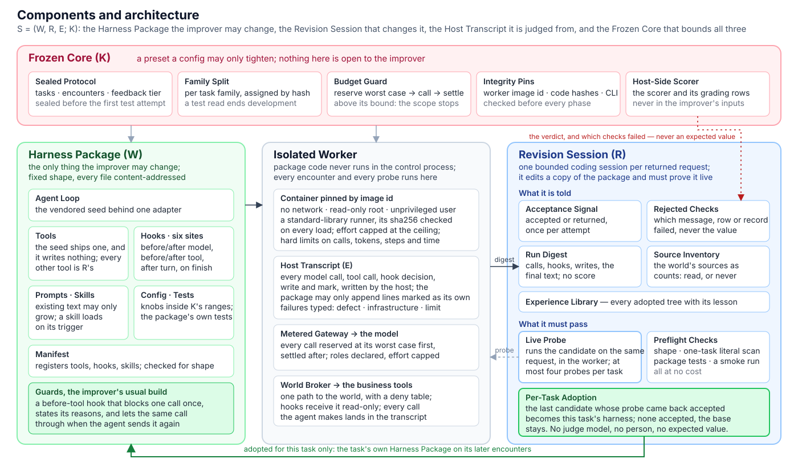
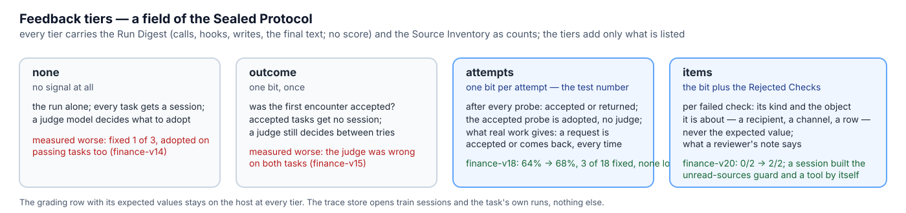

<div align="center">

# reharness

**An agent that gets the same request right the second time.**

[](LICENSE)
[](pyproject.toml)
[](https://github.com/zapier/AutomationBench)
[](README.zh-CN.md)

</div>

reharness runs a business agent on requests that repeat. When a request comes back sent back, an improver reads the agent's own run of it, changes the agent's **harness package** — its tools, hooks, skills, prompts — and tries the change on the same request for real. Only a try that comes back accepted is adopted, and only for that request. No person picks the change, no model judges it, and the improver is never shown an answer: at most *accepted or sent back* per attempt, and *which check was rejected*. Everything the improver cannot touch is frozen — the scorer, the splits, the budget — and package code runs in an isolated worker.

Built and measured on [AutomationBench](https://github.com/zapier/AutomationBench) (47 simulated SaaS tools, scored on the world state the agent leaves behind) with Claude Opus 5.5 as both the agent and the improver, on a subscription budget. On the 50 finance test tasks the steady-state pass rate rose from 64% to 68% with no passing task lost; on train tasks the improver learned, with no hint in its prompt, to open every unread source before writing and to derive figures by code.

<p align="center"></p>

## Contents

- [Key ideas](#key-ideas)
- [Architecture](#architecture)
- [The loop](#the-loop)
- [What the improver is told](#what-the-improver-is-told)
- [Experiment design](#experiment-design)
- [Results](#results)
- [Install](#install)
- [Run](#run)
- [Repository layout](#repository-layout)
- [Citation](#citation)
- [License](#license)

## Key ideas

- **Per-task adoption by an accepted real try.** The improver's candidate runs the request for real and the bit that comes back decides. Accepted tasks are never touched, so learning cannot break a task that was passing. Tasks influence each other only through a library of earlier adoptions.
- **A typed, bounded learning signal.** What the improver may learn is a field of the sealed plan: one bit per attempt, or the bit plus the rejected checks' kinds and objects (which message, which row — never a value), plus an inventory of the world's data sources as counts. The grading rows never leave the host.
- **The improver learns habits, not answers.** Given that signal it built the same two mechanisms in independent sessions, with none of the words in its prompt: a hold that stops the first write until every unread source is opened, and a tool that derives a figure from the inputs read. Every calculation tool in an adopted package was written by the improver; the seed has none.
- **A frozen core with three kinds of guard and nothing else.** Money: every model call reserves its worst case before it is made and settles after; a breach stops the scope. Leakage: splits by task family, plans sealed and committed before the first test attempt. Correctness: a pinned worker image and code hashes, failures typed so only infrastructure is retried.

## Architecture

The system is S = (W, R, E; K): the harness package **W** the improver may change, the improver **R**, the evidence **E** the host records, and the frozen core **K**.

| Component | What it is | Where |
|---|---|---|
| **K** frozen core | a preset a config may only tighten, frozen with the split hash, the worker image id, two code hashes and the CLI version; the sealed plan; the budget book; the scorer and grading rows, which stay on the host | `reharness/activity/presets.py`, `checks.py`; `reharness/evaluate/repeat.py`, `budget.py` |
| **W** harness package | a directory of fixed shape, every file content-addressed: the agent loop (Stirrup, vendored under a provenance file behind one adapter), tools, hooks at six sites, prompts, skills, config, tests, one manifest; shape, byte and count limits and the effort ceiling come from K | `reharness/harness/` |
| **R** improver | one bounded coding session per sent-back task: reads the run's digest, the sources inventory, the rejected items and the library; edits a copy of the package; `try_task` runs it for real; at most four tries | `reharness/improver/repeat.py`, `prompts/repeat.md` |
| **E** evidence | the host-written transcript of every attempt (calls, hooks, writes, marks), the budget book, the events; the package can only add lines marked as its own | `reharness/runtime/trace.py`, `records.py` |
| Runtime | one attempt: a Docker worker pinned by image id (no network, read-only root, unprivileged user, a standard-library runner whose sha256 the host checks on every load); a metered gateway to the model; a broker with a deny table to the world; hooks get it read-only | `reharness/runtime/` |
| Adapter | the benchmark's tasks, tools and official scorer; the views the loop needs — rejected items as kinds and identifiers, the world's sources as counts | `reharness/adapters/automationbench.py` |

The seed carries four generic hooks (a ledger, a triage before the first write, a date anchor, a verify on finish) and one tool that writes nothing, `plan_changes`. The hook sites are before and after the model call, before and after a tool call, after a turn, and on finish; a hook answers in a fixed shape (block, modify, feedback, pushback) and a *hold* — a before-tool hook that blocks one call once with its reasons and lets the same call through when sent again — is the cheapest component the improver has.

## The loop

A sealed plan names the tasks and how many times each is met (three).

1. **Encounter 1** runs the base harness. An accepted request is finished: no session, nothing changes, $0.
2. **Session.** A sent-back request gives R one coding session bound to that task. R reads the digest of the run — each call with its route and error flag, the hooks that acted and what they said, the writes by route, the final text; no score — the world's sources as counts (read by the agent, read only by R's own hook, or never read), the rejected items the plan allows, and the library.
3. **Candidate.** R edits a copy of the package. The host runs the free checks: shape and limits, a scan of the changed lines for a value that belongs to exactly one train task, the declaration against the diff both ways, the package's tests and a smoke run in the worker.
4. **try_task.** The candidate executes the same request once for real. The answer is the new run beside the first, plus the bit — and, under `items`, what that run was sent back for. An unchanged candidate is refused; a changed one may be tried again; four tries per task.
5. **Adopt.** The last candidate whose try was accepted is adopted for this task; none accepted, the base stays. An accepted try the session never handed in is declared by the host from the diff and stands. The adopted tree and its lesson go to the library.
6. **Encounters 2 and 3** run the task's own harness. The report reads encounter 1 (first pass) against encounter 3 (steady state), paired by task family with a bootstrap interval.

Tasks run in parallel, a task's encounters in order, and every encounter is on record, so a rerun pays for nothing twice.

## What the improver is told

<p align="center"></p>

`feedback` is a field of the sealed plan, so the number reported with an activity says what the improver had. The two levels measured worse — a judge model deciding from the run alone — are kept for comparison.

## Experiment design

- **Benchmark.** AutomationBench's finance domain: 100 public tasks, each a business workflow over simulated SaaS tools (sheets, mail, chat, accounting systems), scored by assertions on the world state after the run; a task passes when all its assertions hold. A local score on the public set is not a leaderboard score.
- **Splits.** Tasks are assigned to train and test per task family by hash (50 / 50) and frozen; the split hash is part of K.
- **Sealing.** A plan — the tasks, the encounters, the arms, the feedback level, the base release — is sealed to one file and its reference committed before the first test attempt. The improver's sessions open train sessions and the task's own runs, nothing else; the trace store refuses the rest.
- **Arms.** The learn arm adopts per task; the control arm runs the base every time. The reported number is first pass against steady state on the learn arm, paired per task and resampled over families; the base's own flip rate stands beside it (10–17% of tasks flip between two runs of one package).
- **Model and cost.** The agent and the improver are Claude Opus 5.5 through headless Claude Code, every arm at one effort level (medium unless stated; `automationbench_v2_max` lifts both arms to max). Costs are nominal API-equivalent dollars on a subscription; every model call is reserved at its worst case before it is made.
- **What is disclosed with a number.** The split, the feedback level, the effort, the sample size, the paired difference with its interval, and the cost.

## Results

| Activity | Tasks | Feedback | First pass → steady state | What happened | Cost |
|---|---|---|---|---|---|
| finance-v16 (rehearsal) | 20 train | one bit | 15/20 → 18/20 | 3 of 5 sent-back tasks corrected and holding; accepted tasks untouched | $51 |
| **finance-v18** | **50 test** | one bit | **32/50 (64%) → 34/50 (68%)**, +4.0 [−4.0, +12.0] | 18 sent back, 3 corrected and holding, no passing task lost (the base flipped 4 of 32 at encounter 2, 3 back at 3) | $184 |
| finance-v20 | 2 train | items | 0/2 → 2/2 | two independent sessions built the same unread-sources hold; the agent then read the chat channel and derived 13,162.5 and 105,792 | $11 |
| finance-v24 (effort max) | 3 train | items | 1/3 → 2/3 | one session built a coverage hold, a routing hold and a `tax_estimate` tool; the tax task held at 105,792 twice, which three medium runs never reached; 5–7× the cost | $61 |

What these show, in order: the per-attempt rule adopts only what a real try got accepted, so learning never regressed a passing task; one bit cannot aim the improver at the wrong item (it corrected 3 of 18 on test and changed something else on 12); with the rejected items and the sources inventory it finds generic mechanisms on its own; at effort max it finds them in one session. The remaining failures are documented: ambiguities in a task's own documents that the signal cannot resolve, a world clock the agent is never told, and the benchmark's noise floor. Every activity, including the eight earlier ones under a held-out screen (four sealed finals: +13.0 on Marketing, significant; +4.3, +8.0, +4.0 on finance, inside their intervals; nothing later above the noise floor), is in [docs/RESULTS.md](docs/RESULTS.md); each run's reading is in [docs/JOURNAL.md](docs/JOURNAL.md).

## Install

Python 3.11 or newer, macOS or Linux (on Windows, WSL); Docker for the worker.

```bash
python3 -m venv .venv && . .venv/bin/activate
pip install -e ".[dev,automationbench]"        # installs the `reharness` command
pytest -q                                      # offline: no network, no model
docker build --provenance=false -f docker/worker.Dockerfile -t reharness-worker:py3.12 .
```

Clone AutomationBench and point `[bench] upstream_path` at it; [examples/automationbench/README.md](examples/automationbench/README.md) lists what the adapter imports. The agent and the improver run through headless Claude Code on this machine's subscription login (`claude auth login`); the startup check refuses a login that is not a subscription.

## Run

The quick start runs the loop on five train tasks in a new workspace; the first two commands call no model.

```bash
reharness bench --config examples/automationbench/quickstart-repeat.toml --phase smoke --checks-only   # $0: splits, scorer contract, input audit, the seed's literals
reharness freeze --config examples/automationbench/quickstart-repeat.toml                              # $0: K, the budget root, the sealed plan; prints the [rsi] lines to add
reharness bench --config examples/automationbench/quickstart-repeat.toml --phase repeat --arm learn    # 5 tasks x 3 encounters, R's session on each sent-back one: ~$15-25
reharness bench --config examples/automationbench/quickstart-repeat.toml --phase report                # $0
```

| Command | What it does |
|---|---|
| `reharness bench --config <cfg> --phase smoke --checks-only` | upstream identity, the frozen split, scorer contract, input audit, the seed's literal scan |
| `reharness freeze --config <cfg>` | K, the budget root and the sealed plan; prints the `[rsi]` lines to add |
| `reharness bench --config <cfg> --phase repeat --arm learn\|control [--until task-K]` | the stream; the learn arm adopts per sent-back task, the control arm runs the base every time |
| `reharness bench --config <cfg> --phase report` | the report from the records on disk |

| `[repeat]` option | Behaviour |
|---|---|
| `split = "train" \| "test"` | which split the plan names; a test plan is sealed and committed before the first test attempt |
| `tasks = [...]` or `max_tasks = N` | the named tasks, or the first N in the stream's order |
| `encounters = 3` | how many times each task is met |
| `feedback = "attempts" \| "items" \| "outcome" \| "none"` | what the improver is told (see above) |
| `max_probes = 4` | tries per task |
| `arms = ["learn", "control"]`, `concurrency = 4` | the arms to run; tasks in parallel (a machine setting, not in the plan) |

A config names a preset (`[harness] preset`) and may only tighten it ([docs/design/CONTRACTS.md](docs/design/CONTRACTS.md) §9, [docs/design/EVALUATE.md](docs/design/EVALUATE.md) §6b). `finance-v14.toml` to `finance-v25.toml` are the measured activities; their workspaces hold local, git-ignored run records. For another domain, copy the quick start, change `[bench] domain`, give the copy a new `[workspace] root` and `[rsi] scope_id`, and keep `[repeat] split = "train"` until a test plan is sealed and committed.

## Repository layout

| Path | What it holds |
|---|---|
| `reharness/activity/` | config and presets to K, the workspace, the phases (`phases.py`: `repeat`), the startup checks, the report, the CLI |
| `reharness/improver/repeat.py`, `prompts/repeat.md` | the per-task loop: the label-free digest, `try_task`, the acceptance bit, the rejected items, the world's sources, the library |
| `reharness/evaluate/` | frozen splits, attempts and results, the sealed plans (`repeat.py`, `final.py`), the paired bootstrap, the budget book, releases |
| `reharness/harness/` | the typed package: component kinds, manifest, shape and literal checks, the vendored seed (`seeds/stirrup/`) |
| `reharness/runtime/` | one attempt: gateway, broker, the Docker worker and its runner, egress, the trace |
| `reharness/adapters/automationbench.py` | tasks, business tools, the official scorer, the rejected-items and world-sources views |
| `docs/` | the design (`DESIGN.md`, `design/`), the plan, the results, the journal, the announcement drafts (in Chinese, except this README and the announcement) |
| `reharness/improver/` (the rest), `reharness/memory/`, `reharness/train/` | the earlier held-out screen loop, the memory sidecar (off in every measured preset) and the training stack (never run); kept for the record |

## Citation

```bibtex
@software{reharness2026,
  title   = {reharness: an agent that gets the same request right the second time},
  author  = {The reharness Authors},
  year    = {2026},
  url     = {https://github.com/e13ven-arch/reharness},
  note    = {Bounded self-improvement of an agent's harness package, measured on AutomationBench}
}
```

## License

MIT, see [LICENSE](LICENSE). The Stirrup seed is vendored under its own license in `reharness/harness/seeds/stirrup/vendor/stirrup/LICENSE`; AutomationBench keeps its upstream license.
