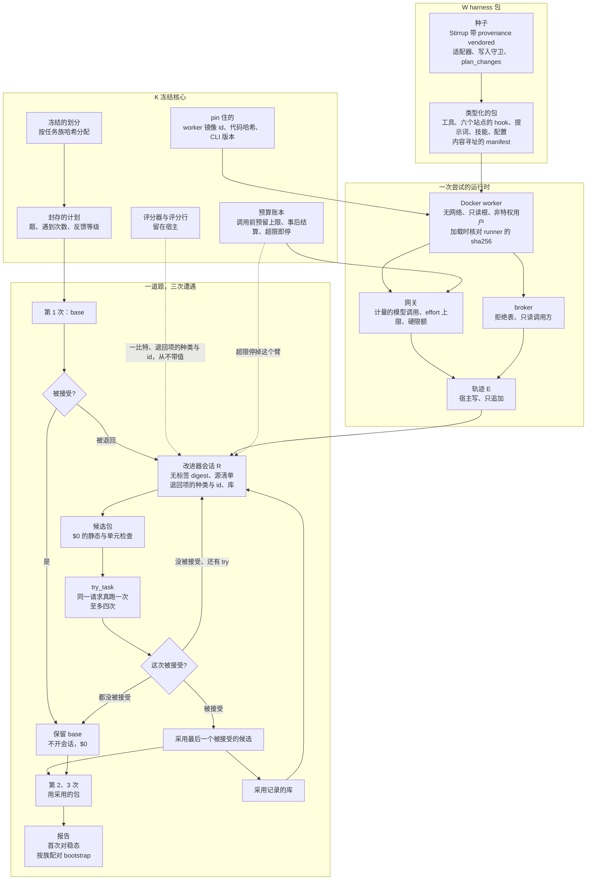

# reharness

[English](README.md) | 中文

**同一个请求，第二次就做对的 agent。** reharness 让业务 agent 处理反复到来的请求。一个请求被退回后，改进器读 agent 自己那次运行，改 agent 的 harness 包——工具、hook、技能、提示词——然后在同一个请求上真跑一次试它。只有被接受的那次 try 才会被采用，而且只对这个请求采用。没有人挑改动，没有模型当裁判，改进器也从来看不到答案：至多每次尝试一个"被接受 / 被退回"的比特，和哪条检查被退回。

在 [AutomationBench](https://github.com/zapier/AutomationBench)（47 个模拟 SaaS 工具，按 agent 留下的世界状态评分）上实现和测量，agent 与改进器都是 Claude Opus 5.5，跑在订阅预算上。

## 怎么工作



### 回路

一份封存的计划点名题目和每道题遇到的次数（三次）。第 1 次用 base harness 跑。请求被接受，这道题就结束：不开会话、什么都不改、$0。被退回，改进器 R 得到一个绑定这道题的编码会话，它采用的东西在第 2、3 次运行。base harness 永远不动；题与题只通过一个"此前采用了什么"的库互相影响。报告读第 1 次的通过率（首次）对第 3 次的（稳态），按任务族配对、bootstrap 给区间。题与题并行，一道题的三次按顺序，每次都在记录里，重跑不会付两次钱。

### 学习信号

R 的输入是：请求；一份没有评分的运行 digest（每次调用的路由和错误标记、出手的 hook 和它说的话、按路由的写入、最后的话）；请求世界里数据源的清单——每个服务有多少条，不含内容，标明 agent 读过 / 只有 R 自己的 hook 读过 / 没读过；库；以及计划允许的反馈。`feedback` 是封存计划的一个字段。`attempts` 是每次尝试一个比特：被接受或被退回。`items` 再加上每条失败检查的种类和它针对的对象（收件人、频道、行 id），从不带期望值；这些行由适配器写，评分行留在宿主。轨迹库只对 train 的会话和这道题自己的运行开放。

### 接受规则

R 改包的一个副本，调 `try_task`。宿主构建候选、跑免费检查（静态：形状、限额、对改动行扫一个只属于一道 train 题的值、声明对 diff 双向核对；单元：包自己的测试和 worker 里的冒烟），然后在同一请求上真跑一次。答复是新运行和第一次的并排，加上那个比特。没改过的候选被拒；每题四次 try。最后，最后一个 try 被接受的候选被这道题采用；都没被接受就保留 base。会话没交上来但 try 被接受的候选，由宿主从 diff 声明，照样算数。

### 冻结核心与三类保护

K 是一个配置只能收紧的预设，连同划分哈希、worker 镜像 id、两个代码哈希和 CLI 版本一起冻结；启动检查遇到不一致就拒绝任何阶段。K 只保留三类保护。钱：每次模型调用先按最坏情况预留、事后结算；结果未知按上限计；量到超过上限就停掉该作用域。泄漏：划分按任务族哈希分配并冻结；计划在第一次 test 尝试前封存、ref 提交；读过 test 就结束开发。正确性：pin 住的镜像与代码；失败分成候选自己的缺陷、基础设施、硬限额三类，只有基础设施重试。

### 包

harness 包是一个固定形状的目录：agent 循环、带 provenance 文件 vendored 的 Stirrup、工具、六个站点的 hook、提示词、技能、配置、测试和一个 manifest，每个文件内容寻址。种子只带四个通用 hook（台账、第一次写入前的 triage、日期锚、收尾核对）和一个不写任何东西的工具 `plan_changes`；采用的包里每一个计算或匹配工具都是 R 写的。文件数、字节数、hook 与工具数、effort 上限都来自 K。

### 运行时

包代码从不在控制进程里跑。它跑在按镜像 id pin 住的 Docker worker 里：无网络、只读根、非特权用户、一个标准库写的 runner，宿主每次加载都核对它的 sha256。包只能经计量网关（effort 封顶、硬限额）碰模型，只能经带拒绝表的 broker 碰世界；hook 拿到的是只读 broker。轨迹由宿主写，包只能加标明是自己写的行。

## 做到了什么

**数字。** AutomationBench 的 50 道 finance test 题，每次尝试一个比特，计划在第一次 test 尝试前封存并提交：首次 32/50（64%），稳态 34/50（68%）。18 道被退回，3 道由被接受的 try 修好并在两次再遇里站住；32 道被接受的题没开会话；没有一道通过题因学习变坏（base 自己在第 2 次翻了 32 道里的 4 道，第 3 次翻回 3 道）。配对差 +4.0 分 [−4.0, +12.0]，50 个族，在区间内。$184，并发 4 跑 3 小时 36 分。

**R 自己学出的东西。** 告诉它哪条检查被退回、世界里有哪些源之后，R 在互不相通的会话里建出了同样的两个机制，提示词里没有这些词：一个在打开所有没读的源之前拦住第一次写入的 hold（四个会话），一个按读到的输入算派生数字的工具（三个活动）。两道数字取决于聊天频道里一条更正的 train 题上，agent 在再遇时读了频道、算出了正确的数：0/2 → 2/2，$11。

**effort = max。** 一个会话把整个机制建全——覆盖源的 hold、送去工具的 hold、一个 `tax_estimate` 工具——税额题在两次再遇里都算对并站住，medium 下三个活动都没做到；代价五到七倍（三道题 $61）。max 下的 test 抽样跑了四道就被预算保护停住：一次调用 400,793 输入 token，超过 400,000 的上限。

**费用。** medium 下三次遭遇约 $3.70/题；退单题的会话一比特时 $1～4、退回项时 $3～6、max 时 $18～25。

**边界。**
- test 上 +4.0 分在区间内；18 道退单修 3 道，train 上 5 道修 3 道。
- test 上没跑对照臂，用 base 自己的翻转代替。
- 薄信号分不出的文档歧义，以及从不告诉 agent 的世界时钟。
- 10～17% 的噪声底：同一个包跑两次有这么多题翻转。
- max 的抽样只跑到四道。

**这条回路之前。** 八个活动（约 $1,150）在带确认翻转的留出筛选下找跨不同工作流泛化的包；四次封存 final 读到 +13.0（Marketing，显著）、+4.3、+8.0、+4.0（finance，区间内），之后没有东西高于噪声底。改变主线的诊断：基准的 150 道 train 题是 150 个不同的工作流，而真实工作是同一个模式换参数反复来。[docs/RESULTS.md](docs/RESULTS.md) 有每个活动。

## 快速上手

Python 3.11 或更新，macOS 或 Linux（Windows 用 WSL）。

```bash
python3 -m venv .venv && . .venv/bin/activate
pip install -e ".[dev,automationbench]"        # 装上 `reharness` 命令
pytest -q                                      # 离线：不联网、不调模型
```

clone AutomationBench 并把 `[bench] upstream_path` 指向它（要装什么见 [examples/automationbench/README.md](examples/automationbench/README.md)），构建 worker 镜像，然后在新工作区用 5 道 train 题跑重复流。前两条命令不调模型：

```bash
docker build --provenance=false -f docker/worker.Dockerfile -t reharness-worker:py3.12 .
reharness bench --config examples/automationbench/quickstart-repeat.toml --phase smoke --checks-only   # $0：划分、评分器契约、输入审计、种子的字面量
reharness freeze --config examples/automationbench/quickstart-repeat.toml                              # $0：K、预算根、封存的计划；打印要加进 [rsi] 的行
reharness bench --config examples/automationbench/quickstart-repeat.toml --phase repeat --arm learn    # 5 道 × 3 次，退单题各开一个 R 会话：约 $15～25
reharness bench --config examples/automationbench/quickstart-repeat.toml --phase report                # $0
```

actor（`[model]`）与 R（`[research_model]`）经本机 Claude 订阅登录（`claude auth login`）下的无头 Claude Code 调用，每次都是空目录、无工具的新 `claude -p`；启动检查拒绝非订阅登录。预设把 effort 封顶在 medium，`automationbench_v2_max` 把两臂放到 max。费用是名义 API 等价美元，不是账单。

| 命令 | 做什么 |
|---|---|
| `reharness bench --config <cfg> --phase smoke --checks-only` | 上游身份、冻结的划分、评分器契约、输入审计、种子的字面量扫描；不调模型 |
| `reharness freeze --config <cfg>` | K、预算根与封存的计划；打印要加的 `[rsi]` 行 |
| `reharness bench --config <cfg> --phase repeat --arm learn\|control [--until task-K]` | 重复流；学习臂给每道退单题采用一个包，对照臂每次跑 base |
| `reharness bench --config <cfg> --phase report` | 从磁盘记录出报告；不调模型 |

配置点名一个预设（`[harness] preset`），只能收紧它；`[repeat]` 表见 [docs/design/EVALUATE.md](docs/design/EVALUATE.md) §6b。`finance-v14.toml`～`finance-v25.toml` 是实测活动，文件头列了步骤、费用和用途；它们的工作区放本机的、git 忽略的运行记录。换领域：复制 quickstart，改 `[bench] domain`，给新的 `[workspace] root` 和 `[rsi] scope_id`，在为 test 封存并提交计划之前保持 `[repeat] split = "train"`。

## 代码结构

| 路径 | 内容 |
|---|---|
| `reharness/activity/` | 配置与预设到 K、工作区、阶段（`phases.py`：`repeat`）、启动检查、报告、CLI |
| `reharness/improver/repeat.py`、`prompts/repeat.md` | 逐题回路：无标签 digest、`try_task`、接受比特、退回项、源清单、库 |
| `reharness/evaluate/` | 冻结的划分、尝试与结果、封存的计划（`repeat.py`、`final.py`）、配对 bootstrap、预算账本、发布 |
| `reharness/harness/` | 类型化的包：组件种类、manifest、形状与字面量检查、vendored 的种子（`seeds/stirrup/`） |
| `reharness/runtime/` | 一次尝试：网关、broker、Docker worker 与 runner、出口、轨迹 |
| `reharness/adapters/automationbench.py` | 任务、业务工具、官方评分器、退回项与源清单的视图 |
| `reharness/improver/`（其余）、`reharness/memory/`、`reharness/train/` | 早先的留出筛选回路（轮次、验收阶梯、筛选、前沿）、memory sidecar（实测预设里都关着）、训练栈（没跑过）；留作记录 |

## 文档

设计文档是中文的；架构由 README 自己讲。

- [docs/DESIGN.md](docs/DESIGN.md)：架构与每次实测逼出的修订；§6.23～§6.24 重复流、退回项、源清单、R 造工具。
- [docs/PLAN.md](docs/PLAN.md)：现在在哪、规则、等用户定的事。
- [docs/RESULTS.md](docs/RESULTS.md) 与 [docs/JOURNAL.md](docs/JOURNAL.md)：结果，以及每次改动与运行带数字的日志，倒序。
- [docs/design/](docs/design/README.md)：模块设计与接口；[docs/history/](docs/history/)：计划、分析、框架调研与发布稿。

## 许可证

MIT，见 [LICENSE](LICENSE)。Stirrup 种子按它自己的许可证 vendored 在 `reharness/harness/seeds/stirrup/vendor/stirrup/LICENSE`。
