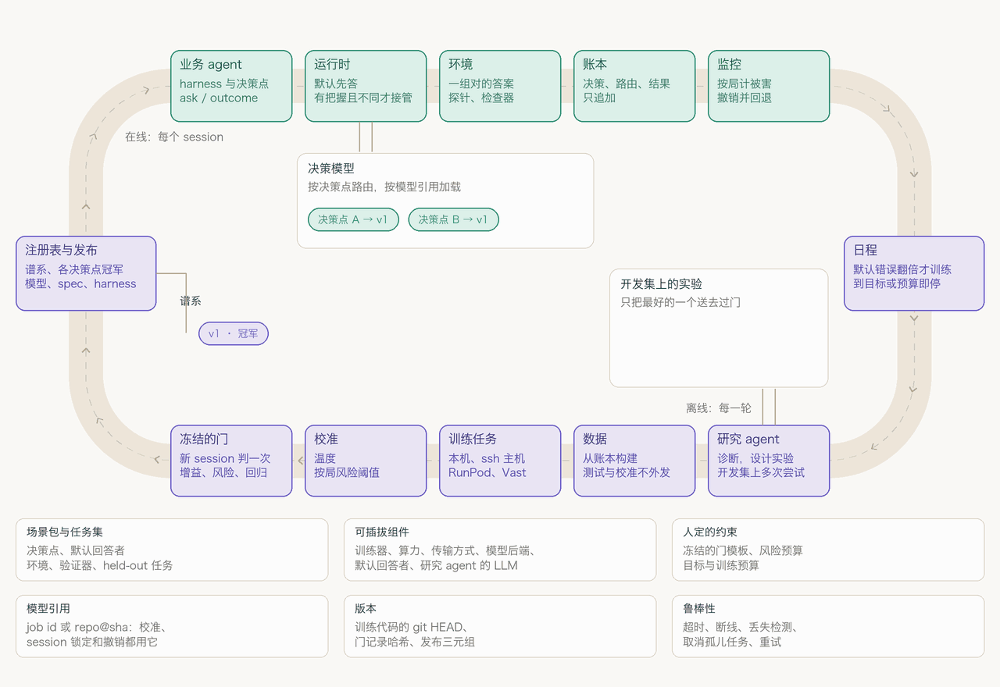

# ouroloop

[English](README.md) | 中文

一个以可学习决策策略为核心的轻量 RSI 框架：既改进 agent 怎样完成任务，也改进系统怎样诊断失败、设计实验和产生下一版本。

核心研究方向是从执行反馈中训练小而可复用的决策模型。v0.5 设计让 prompt、规则、工作流和模型共用策略接口，任务策略与研究策略共用证据、评测和版本机制。训练出的模型需要证明额外的任务效果或成本收益，不要求每次改进都训练。

AutomationBench Marketing 是首个证明场，与业界领先模型和同底座起点比较完整任务表现。v0.5 的完整目标还包括：评测更新后的研究策略，并将它用于下一轮改进。这条研究递归路径的工程链已实现并由离线夹具验收，尚无真实模型证据。

**实现状态：** 决策层、账本、训练作业、模型库与服务已有实现；AutomationBench 的运行契约也已实现——任务分组在看到第一个结果前冻结，官方评分器读工具留下的世界，以及一组说明"这个驱动器测的是上游测的东西"的检查（`ouroloop bench --phase smoke`）。它已在真实 checkout（上游 `4a8e106`、package 1.0.6）上核验：25 个开发任务全部通过契约检查，上游自己的 rubric 入口、服务订阅门和工具 schema 都与本适配器一致。

改进闭环现已实现，并由离线夹具验收：注册目标上的类型化策略、携带完整请求与工具返回的业务完成视图、preflight 后 CAS 安装的完整 W/R 版本、只由观测事实产生的反馈、无晋升副作用的训练、固定门下的配对完整任务评测、研究一轮、单一共享预算账、以产出比较两个研究策略的 campaign，以及七个 benchmark 阶段与离线报告（`python -m pytest -q` → 547 passed；见[实现状态](docs/ROADMAP.md#5-实现状态2026-09-27)）。

**还没用真实模型跑过，因此本仓库没有任何 benchmark 成绩。** 夹具证明的是路径真实——安装的策略确实被加载、标签来自观测事实、指针只经凭据移动、崩溃后可恢复——夹具的数字由夹具定义；C1～C4 全部未运行，夹具里的研究改动由脚本提出并标 `scripted`，不是自动发现。见 [v0.5 设计](docs/DESIGN.md)与[实施路线图](docs/ROADMAP.md)。

agent 会反复判断是否重试、保留上下文、验证或结束。ouroloop 将适合学习的判断声明为决策点，接入 Jev 或自己训练的小模型；未启用、弃权或服务失败时走既定默认策略。有依据的动作标签才能进入监督训练，整段任务得分不能直接当每一步的标签。候选接口可以提出 spec、训练配方和 prompt 改动，接下来要将它们与完整业务任务评测连接起来。

## RSI 是怎么发生的

`ouroloop demo <scenario> --generations N` 按代运行这个循环（[ouroloop/generations.py](ouroloop/generations.py)）；自己的 harness 在每个 session 里跑在线的一半。只有 demo 会先为这一轮做计划（`ouroloop plan` 给出同一份判断）：只有通过准入的计划才会训练，没有新东西可学的一轮不花算力。`ouroloop evolve` 每次调用都跑一轮（训练、校准、过门、晋升），不管计划怎么说。

<p align="center"></p>

图示说明反馈循环的设计，不是业务实测结果。现有场景循环采集决策和标签，由内置计划器准入，训练、评测并在后续 session 使用选定版本。自动研究员与完整业务任务评测器仍需接入。

任务改进是：更新后的策略改变后续执行到达的状态，新反馈再驱动下一轮更新。完整设计还包括研究改进：更新诊断、经验检索或实验方法，在相同预算下验证其后续产出，再用于下一轮研究。该路径可通过 prompt、规则和研究工具实现，不必另训一个研究员模型。两种改进都以实际结果验证，不保证下一代更强。

现有接管策略有校准阈值、按有标签 session 的风险检查和运行时撤销，依赖相应反馈与统计假设，不构成“业务任务失败率最多 5%”的保证。拟建 benchmark profile 按独立的完整任务协议评测，保留原部署 profile。

`ouroloop research` 当前与场景世代循环分别运行；研究、业务反馈、训练和任务评测的接线见路线图。

## 快速上手

需要 Python ≥3.11，支持 macOS 和 Linux（agent 的工具依赖 bash），Windows 请用 WSL。

```bash
python3.12 -m venv .venv && . .venv/bin/activate
pip install -e ".[dev]"      # 默认只依赖 httpx
pytest -q                    # 离线测试：不联网，不跑模型
ouroloop demo                # 用合成数据离线跑一轮研究循环
ouroloop demo snake --config examples/snake/offline.toml   # 贪吃蛇连跑几代，用小模型（见 examples/snake）
```

接入 Jev：把 key 写进仓库根目录的 `.env`（`TYPESAFE_API_KEY=...`，已被 git 忽略）。

```bash
ouroloop smoke                   # 三种题型各问一次 Jev
ouroloop demo --judge jev        # 研究循环里的判断交给 Jev
ouroloop decide --backend jev --type noul --question "The failure is transient" --state "ConnectionResetError"
pytest -m live                   # 真实 API 的冒烟测试
```

用 Claude：`pip install -e ".[anthropic]"`，并设置 `ANTHROPIC_API_KEY`。

```bash
ouroloop run "修好 tests 里失败的测试" --llm anthropic --judge jev     # agent 在当前目录干活，决策点交给 Jev
ouroloop run "..." --llm openai_compat --model qwen3 --base-url http://localhost:11434/v1
ouroloop run "..." --llm anthropic --verify "pytest -q" --small-model claude-haiku-4-5  # 验证命令和小模型档位
ouroloop gate freeze --config examples/ouroloop.toml                # 由人冻结一次：所有晋升都过这个门
ouroloop research --config examples/ouroloop.toml --rounds 3        # 对积累的账本跑几轮研究循环
ouroloop plan --config examples/ouroloop.toml                       # 数据现状，以及这一轮该不该训练
ouroloop evolve --config examples/ouroloop.toml                     # 用账本训练新的 TDE，过晋升门才替换
ouroloop calibrate --config examples/ouroloop.toml                  # 报告每个决策点的温度和阈值，不写入
ouroloop models --dir examples/workspace                            # 查看模型谱系；加 --rollback 回退并撤销
```

门模板只能收紧、不能放宽 5% 的风险、每次过门需要的 30 个新 session 和 bootstrap 次数。每轮的门记录、它的使用和结论都是账本里的事件，`gates/` 里只是副本。只有门记录接受过的候选才能晋升、作答和执行。

关于 TDE：TDE 是单独的项目，之后另行开源；本仓库里的 `tde` 训练器记录了 ouroloop 怎么训练它：作为一个任务（`ouroloop/worker.py`）在本机运行，或者设 `host = "user@box"` 通过 ssh 在 GPU 主机上运行，每个任务在那台机器上有一个新目录 `<jobs_root>/<job id>/`。任务把 run 发布到模型库 `[store]`，训练出的模型是一个引用：`type = "dir"` 时是任务 id（一个目录，有训练主机时在那台主机上），`type = "hf"` 时是 `<repo>@<commit>`（run 提交一次到私有的 Hugging Face 仓库）。`[serving]`（旧名 `[models]`）说明这些引用怎么问：`url`（和 `token_env`）指向能读模型库的主机上的 `ouroloop serve`，或者在进程内从模型库加载。过门的模型先部署再成为冠军（部署失败用 `ouroloop deploy <version>` 重试）。控制面、训练、模型库、服务是四个角色；一台 GPU 主机包下其中三个只是一种布局（docs/TRAINING_HOSTS.md）。没有 TDE 时，训练管线用内置的签名小模型（`type = "signature"`）也能完整跑通；接自己的模型就写一个训练器插件（`ouroloop/trainers/__init__.py`，docs/TRAINING_HOSTS.md §1）：`train` 作为作业在训练机器上跑，`backend(run, ref, options)` 为服务加载模型；配置里写 `type = "your.module"`。写成 `type = "your.module:YourTrainer"` 的训练器在当前进程里训练，后端也在这里建，不经过模型库和 `[serving]`，只用于测试和 demo。

要让 TDE 实时回答单个决策，就在 GPU 主机上常驻一个决策服务，harness 这边用 `type = "http"` 的后端连过去：

```bash
OUROLOOP_TOKEN=... ouroloop serve --config host.toml --host 0.0.0.0 --port 8765
```

绑定到本机以外的地址时必须设置 `OUROLOOP_TOKEN`，因为 `/outcome` 会往账本里写训练标签。

模型接入：研究 agent 和 `ouroloop run` 可以接任何模型。
- Claude 走官方 SDK：`[llm] type = "anthropic"`，默认 `claude-opus-5`，在 `.env` 里写 `ANTHROPIC_API_KEY`。
- 其他模型走 OpenAI 兼容接口：`type = "openai_compat"`，智谱、OpenRouter、DeepSeek、vLLM、Ollama 等都行。遇到限流和 5xx 会自动重试。模型特有的请求字段写在 `[llm.extra]` 里，比如 GLM 的思考强度。
- 智谱的完整配置见 [examples/zhipu.toml](examples/zhipu.toml)。
- 配置里的 `env_file` 指定另一个 `.env`，路径相对于配置文件，在别的目录运行时也能读到 key。

任务集和 prompt 进化：[evals/tasks](evals/tasks) 里有 10 个小编码任务，其中 7 个开发任务、3 个 held-out 任务。每个任务是一个 TOML 文件，写着任务描述、初始文件、检查命令，以及跑完之后才写进去的隐藏测试，agent 改不到这些测试。得分是通过的检查项比例。

```bash
ouroloop suite --validate --tasks evals/tasks                # 不调用 LLM：确认每个任务原样不通过、参考答案全通过
ouroloop suite --config examples/zhipu.toml                  # 用当前冠军 prompt 跑一遍任务集
ouroloop research --config examples/zhipu.toml --rounds 2    # 配了 [suite] 时，研究 agent 也会改 harness prompt
```

prompt 候选按下面几步评测：

- 只改了空白字符的直接拒绝；
- 先在前几个开发任务上筛一遍，不比冠军差，冠军和候选才在全部任务（含 held-out）上都重新跑一遍，再过同一个晋升门；
- 研究 agent 看不到 held-out 任务的结果；
- 每次运行按（prompt、模型、任务、第几次）记在 `harness/runs.jsonl`，记下的结果只用于筛选；每轮只过一次门，同一个 prompt 不能靠重跑碰运气。

任务跑完时的检查结果，也会作为这次运行里 stop / route 决策的标签。跑任务集时 agent 会自动执行 bash：命令在临时目录里执行，黑名单照样生效。不放心模型的话，放在容器或虚拟机里跑。

可选的数据来源：`ouroloop hook print-settings` 会打印一段 Claude Code 的 hooks 配置。放进 `.claude/settings.json` 以后，日常 Claude Code 会话里的工具调用和结果会被记进账本。默认只记录，不改变 Claude Code 的任何行为。

工具调用默认要你批准（终端里问 y/N），加 `--yes` 自动放行；黑名单里的命令（`rm -rf /`、`curl ... | sh` 等）永远不执行。配置示例见 [examples/ouroloop.toml](examples/ouroloop.toml)。

`--verify` 给一条检查命令，退出码 0 表示任务完成。agent 想结束时先跑它，没通过就把输出发回去让 agent 接着干（最多 2 次）；检查结果同时是 stop 决策点的标签。`--small-model` 配一个同一接口下更便宜的模型，route 决策点打开之后决定每一步用哪个，在那之前每一步都用大模型；任务成败是小模型步骤的弱标签。交互运行时，结束后会问你任务做完没有，回答也记进账本。

## AutomationBench

[AutomationBench](https://github.com/zapier/AutomationBench) 用 47 个模拟 SaaS 工具搭出业务流程，按 agent 最后留下的世界状态判定任务是否完成。它是独立运行时，ouroloop 延迟导入：把它 clone 下来，让 `[bench] upstream_path` 指向那个目录（需要装什么见 [examples/automationbench/README.md](examples/automationbench/README.md)）。

```bash
ouroloop bench --config examples/automationbench/marketing.toml --phase smoke --checks-only   # 不调模型
ouroloop bench --config examples/automationbench/marketing.toml --phase smoke                 # 再跑几个开发任务
```

smoke 阶段报告这是哪个上游版本，把 train/dev/test 任务分组冻结到 `<workspace>/bench/<domain>/splits.json`（在看到任何结果之前），把本适配器与上游自己的 rubric 入口、服务订阅门和工具 schema 对比，审计有没有评分信息进到 agent 的输入里，然后完整跑几个开发任务。它不对能力下任何结论；本地公开任务集的分数也不是官方榜单成绩——榜单跑的是私有任务集。

agent 拿到的是任务 prompt 和工具 schema，断言与初始状态在它收不到的对象里；分数来自工具留下的世界，所以写错记录再汇报成功，得到的就是写错的那份分数。其余阶段跑的是同一条闭环：`baseline` 用同一个驱动器测合理基线与声明的领先模型，`collect` 离线给完成判断打标签，`improve` 以固定研究策略跑任务改进，`research` 在隔离两支中比较两个研究策略，`evaluate` 运行一次密封的最终计划，`report` 从磁盘上的记录重算一切。它们都读工作区里的冻结计划对象，而不是配置文件里的可改设置；缺计划或缺模型表的阶段会在调用模型之前说明缺什么。

## 代码结构

| 路径 | 内容 |
|---|---|
| `ouroloop/decision.py` | 决策点和 spec（问题、候选、view 参数） |
| `ouroloop/policy.py` | 执行规则、阈值拟合、探索和倾向分 |
| `ouroloop/ledger.py` | 账本、原始上下文、冠军 spec |
| `ouroloop/runtime.py` | 把决策点、后端、默认回答者和账本串起来；每个 session 固定自己的发布三元组 |
| `ouroloop/release.py` | session 运行的发布：旧三元组，以及完整 W/R 版本的凭据、安装、恢复与撤销 |
| `ouroloop/policies.py` | 已注册的策略目标、每个目标可绑定什么、装配、会话 pin 与候选构建 |
| `ouroloop/agent/` | 最小 agent：loop、read / write / edit / bash 四个工具、harness prompt、任务集 |
| `ouroloop/points/` | 内置决策点 retry、compact、tool_gate、stop、route，以及命令黑名单 |
| `ouroloop/chat.py` | 与模型无关的对话格式 |
| `ouroloop/serve.py` | HTTP 决策服务 |
| `ouroloop/benchmark.py` | benchmark 运行契约：冻结的任务分组、运行身份、一次尝试的结果 |
| `ouroloop/bench.py` | `ouroloop bench` 的各个 phase、启动检查，以及一次改进活动共用的接线 |
| `ouroloop/report.py` | 离线报告：身份与范围、任务效果、成本、改进与 RSI 证据、C1～C4 状态 |
| `ouroloop/adapters/` | AutomationBench（任务、业务工具、官方评分器）；Claude Code hooks 适配器（可选的数据来源） |
| `ouroloop/backends/` | `mock`、`jev`、`tde`、`llm` 四种决策后端 |
| `ouroloop/providers/` | LLM 接入：Anthropic（官方 SDK）、OpenAI 兼容接口 |
| `ouroloop/research/` | 问题转换、研究 agent 接口和默认实现、一轮研究流程，研究员可读什么（`context.py`）、实际跑了什么（`inspection.py`）、提案与准入（`experiment.py`）、研究策略 campaign（`campaign.py`） |
| `ouroloop/evolve/` | 公共契约与对象库（`contracts.py`）、反馈构造器、建数据、数据检查、训练（签名小模型 / 本机 TDE / 远程 TDE）、校准、冻结的晋升门和门记录、配对任务门（`task_gate.py`）、执行状态机与预算账（`execution.py`）、模型注册表、经验记录 |

## 状态

当前代码具备决策点、账本、监督训练作业、训练器插件、模型库与服务、校准、版本管理、场景世代循环，以及独立的研究与 prompt 候选路径。

设计 v0.5 的首个证明场是 AutomationBench Marketing。环境适配、任务组划分、完整任务运行器和 train 完成度探针已实现，契约检查在真实 checkout 上通过，测试跑在上游的微缩替身（`tests/fake_upstream`）上；尚未用真实模型运行。待完成：真实轨迹与有效训练数据、配对任务评测与晋升、研究循环与经验继承、研究策略更新及回用、领先模型比较和可复现报告。**本仓库尚未测过任何 AutomationBench 成绩。** 历史证据保留在 [docs/JOURNAL.md](docs/JOURNAL.md)。

开发交接见 [架构审查](docs/RSI_REVIEW.md)与[模块详细设计及验收用例](docs/modules/README.md)；这些是待实现契约，不代表已有业务收益。

权威设计见 [docs/DESIGN.md](docs/DESIGN.md)，实现状态与下一步见 [docs/ROADMAP.md](docs/ROADMAP.md)，研究员职责与接口见 [docs/RESEARCH_AGENT.md](docs/RESEARCH_AGENT.md)，演示与结果呈现见 [docs/DEMO.md](docs/DEMO.md)，改动和证据见 [docs/JOURNAL.md](docs/JOURNAL.md)。

## 许可证

MIT，见 [LICENSE](LICENSE)。
