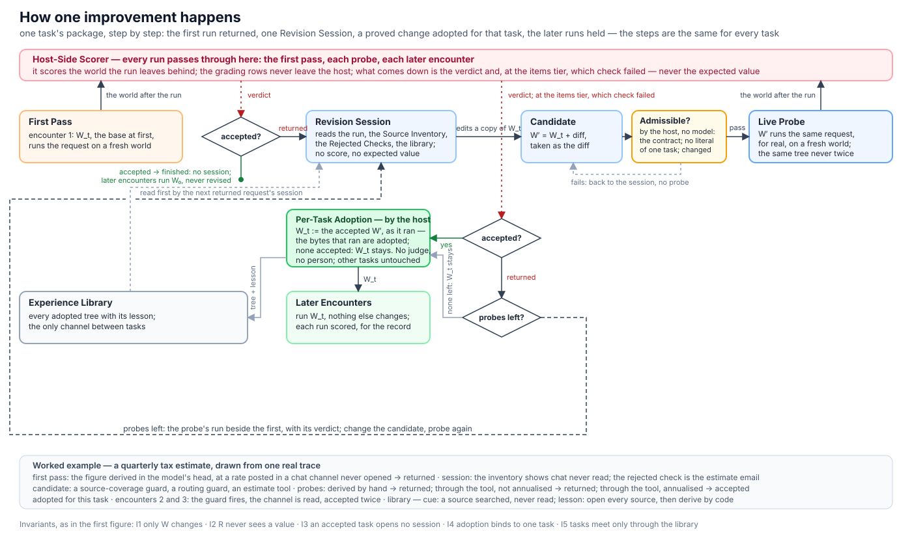

<div align="center">

# reharness

**自我改进的 agent：改写自己的 harness 而不是模型，每个改动都真跑一次来证明。**

[](LICENSE)
[](pyproject.toml)
[](https://github.com/zapier/AutomationBench)
[](#结果)
[](README.md)

</div>

reharness 是一个自我改进的 agent harness：有界的递归自我改进（recursive self-improvement），由 agent 自己的模型来修订 agent 运行其中的 harness，从不改模型本身。业务 agent 处理反复到来的请求。一个请求被退回后，一个**修订会话**（Revision Session）读 agent 自己那次运行，改 agent 的 **Harness 包**——工具、hook、技能、提示词——再用一次**实跑探针**（Live Probe）证明这个改动：候选在同一个请求上真跑一次。只有被接受的探针才会被采用，而且只对这个请求采用（**按题采用**，Per-Task Adoption）。没有人挑改动，没有模型当裁判，会话也从来看不到答案：至多每次尝试一个"被接受 / 被退回"的信号，和*哪条检查没过*。会话碰不到的东西全部是**冻结核心**——评分器、会话能被告知什么、包的契约、各项上界——包代码跑在隔离的 worker 里。agent 从自己的运行里学到的是 harness 工程——一个 guard、一个工具、一条提示词——而不是答案。

在 [AutomationBench](https://github.com/zapier/AutomationBench)（47 个模拟 SaaS 工具，按 agent 留下的世界状态评分）上实现和测量，agent 与会话都是 Claude Opus 5.5，跑在订阅预算上。finance 的 test 题上稳态通过率从 64% 到 68%，没有一道通过题变坏；train 题上会话在提示词没有任何暗示的情况下，自己学会了写入前打开每个没读的源、数字由代码算。

<p align="center"></p>

## 目录

- [核心想法](#核心想法)
- [架构](#架构)
- [一次提升如何发生](#一次提升如何发生)
- [反馈档](#反馈档)
- [实验设计](#实验设计)
- [结果](#结果)
- [安装](#安装)
- [运行](#运行)
- [仓库结构](#仓库结构)
- [参与贡献](#参与贡献)
- [引用](#引用)
- [许可证](#许可证)

## 核心想法

- **按题采用，凭一次被接受的实跑探针。** 会话的候选真跑这个请求，回来的裁决决定；规则由宿主执行，没有裁判模型，没有人。被接受的题不开会话，它的包从不被修订；采用只绑定一道题，所以在一个请求上证明过的改动到不了别的题。题与题只通过一个记录此前采用的经验库互相影响。
- **类型化、有界的学习信号。** 会话能学什么是封存协议的一个字段——反馈档：只有接受信号（每次尝试一个"被接受 / 被退回"），或者信号加上被退回检查的种类与对象（哪封邮件、哪一行——从不带值），再加一份只有条数的源清单。评分行从不离开宿主。
- **会话学的是习惯，不是答案。** 在这个信号下，它在互不相通的会话里建出了同样的两个机制，提示词里没有这些词：第一次写入前打开每个没读的源的守卫，以及按读到的输入算数字的工具。采用的包里每一个计算工具都是会话写的，种子里一个都没有。
- **四条不变量构成的冻结核心。** 宿主侧评分器，它的评分行从不离开宿主；反馈档，规定什么能过到会话那边；包契约——固定形状、字节数、数量与 effort 上限，以及"包里没有答案"：候选的改动行对着 train 评分行扫描，只属于一道题的值被拒；上界——探针、步数、token、时间、钱，会话无法放大。回路外面是测量，不是机制：按任务族划分、协议在第一次 test 尝试前封存并提交、worker 镜像与代码的完整性 pin、把每次模型调用先按最坏情况预留的预算守卫。

## 架构

系统记作 S = (W, R, E; K)：会话可以改的 Harness 包 **W**、改它的修订会话 **R**、评判它所依据的宿主轨迹 **E**、约束这三者的冻结核心 **K**。

| 组件 | 是什么 | 在哪 |
|---|---|---|
| **K** 冻结核心 | 四条不变量——宿主侧评分器与评分行，从不离开宿主；反馈档；包契约，含单题字面量扫描；上界——装在配置只能收紧的预设里，连同划分哈希、worker 镜像 id、两个代码哈希和 CLI 版本（完整性 pin）、封存协议、预算守卫一起冻结 | `reharness/activity/presets.py`、`checks.py`；`reharness/evaluate/repeat.py`、`budget.py` |
| **W** Harness 包 | 固定形状的目录，每个文件内容寻址：agent 循环（Stirrup，带 provenance 文件 vendored 在一个适配器后面）、工具、六个站点的 hook、提示词、技能、配置、测试、一个 manifest；形状、字节数、数量上限和 effort 上限来自 K | `reharness/harness/` |
| **R** 修订会话 | 每道退回题一个有界的编码会话：读运行摘要、源清单、被退回的检查和经验库；改包的副本；每次探针前宿主按确定性规则判候选是否准入；实跑探针（`try_task`）真跑；至多四次 | `reharness/improver/repeat.py`、`prompts/repeat.md` |
| **E** 宿主轨迹 | 宿主写的每次尝试的记录（调用、hook、写入、标记）、预算账本、事件；包只能加标明是自己写的行 | `reharness/runtime/trace.py`、`records.py` |
| 隔离 worker | 一次尝试：按镜像 id pin 住的 Docker 容器（无网络、只读根、非特权用户、标准库 runner，宿主每次加载核对 sha256）；到模型的计量网关；到业务工具的带拒绝表的世界 broker；hook 拿到的是只读的 | `reharness/runtime/` |
| 适配器 | 基准的任务、工具与官方评分器；回路需要的视图——被退回检查的种类与标识、源清单的条数 | `reharness/adapters/automationbench.py` |

种子带四个通用 hook（台账、第一次写入前的 triage、日期锚、收尾核对）和一个不写任何东西的工具 `plan_changes`。六个 hook 站点是模型调用前后、工具调用前后、每轮之后、收尾时；hook 以固定形状回答（block、modify、feedback、pushback），而*守卫*——在工具调用前拦住一次、给出理由、同一调用重发即放行的 hook——是会话手里最便宜的组件。

## 一次提升如何发生

<p align="center"></p>

一份封存协议点名题目和每道题遇到的次数（三次）。图里跟的是一道题的包走过的各步，每道题都一样；图下方的例子是一个季度税额预估请求，取自一条真实轨迹（finance-v24，effort max）。

1. **首次。** 第 1 次用 base 包跑。被接受的请求到此结束：不开会话，它的包从不被修订。
2. **修订会话。** 被退回的请求给 R 一个绑定这道题的编码会话。它读运行摘要——每次调用的路由和错误标记、出手的 hook 和它说的话、按路由的写入、最后的话；没有评分——源清单（每个源：agent 读过 / 只有会话自己的 hook 读过 / 没读过）、协议允许的被退回检查、经验库。
3. **候选与准入。** R 改包的一个副本；候选是这道题的包加上 diff，按 diff 算，不按会话的说法算。任何探针之前，宿主按确定性规则、不问模型判准入：在包契约之内（形状与限额、manifest 对 diff 双向核对）、没有单题字面量（改动行对着 train 评分行扫描）、确实改过（同一棵树不探两次）。包自己的测试和 worker 里的冒烟放在同一个点上做 fail-fast，不参与裁定。
4. **实跑探针。** 候选在同一请求上真跑一次。答复是新运行和第一次的并排，加上裁决——items 档下还有这次没过的检查。没改过的候选被拒，改过可以再探；每题四次。
5. **按题采用。** 最后一个探针被接受的候选被这道题采用；都没被接受就保留 base。会话没交上来但探针被接受的候选，由宿主从 diff 声明，照样算数。采用的树和教训进经验库。
6. **稳态。** 第 2、3 次用这道题自己的包跑。报告读第 1 次（首次）对第 3 次（稳态），按任务族配对、bootstrap 给区间。

题与题并行，一道题的三次按顺序，每次都在记录里，重跑不会付两次钱。

## 反馈档

<p align="center"></p>

`feedback` 是封存协议的一个字段，所以每个活动报的数都说明了会话拿到了什么。量出来更差的两个档——裁判模型只凭运行判断——留作对比。

## 实验设计

- **基准。** AutomationBench 的 finance 域：100 道公开题，每道是跨模拟 SaaS 工具（表格、邮件、聊天、账务系统）的业务流程，按运行后世界状态上的断言评分，断言全部成立才算通过。公开题集上的本地分数不是榜单分数。
- **划分。** 按任务族哈希分到 train 与 test（50 / 50）并冻结；划分哈希是 K 的一部分。
- **封存。** 一份协议——题目、次数、臂、反馈档、base 版本——封存成一个文件，ref 在第一次 test 尝试前提交。会话只能打开 train 的会话和这道题自己的运行，轨迹库拒绝其他的。
- **臂。** 学习臂按题采用；对照臂每次跑 base。报的数是学习臂的首次对稳态，按题配对、按族重采样；base 自己的翻转率放在旁边（同一个包跑两次有 10～17% 的题翻转）。
- **模型与费用。** agent 与会话都是经无头 Claude Code 调用的 Claude Opus 5.5，所有臂同一 effort（未注明即 medium；`automationbench_v2_max` 把两臂放到 max）。费用是订阅上的名义 API 等价美元；预算守卫把每次模型调用先按最坏情况预留。
- **报数时披露什么。** 划分、反馈档、effort、样本量、配对差与区间、费用。

## 结果

参照点是模型原样在 AutomationBench 官方榜单上的分数；结果是同一个模型跑 reharness 从它自己的运行里建出来的 harness，在基准的留出题上、协议在第一次 test 尝试前封存。

| | 通过率 | 费用 |
|---|---|---|
| Claude Opus 5.5 在 AutomationBench 榜单上 | 42.47% | — |
| AutomationBench 榜单上 finance 的最高分 | 50.00% | — |
| **Claude Opus 5.5 + reharness——finance，反复到来的请求，稳态** | **68%**（比首次 +4.0，[−4.0, +12.0]；没有一道通过题变坏） | $184 |
| Claude Opus 5.5 + reharness——finance，整个域演化出一个包 | 62.7%（+8.0，[−4.0, +22.7]；每次尝试便宜 22%） | $210 |
| Claude Opus 5.5 + reharness——Marketing，整个域演化出一个包 | 54.3%（+13.0，[+2.2, +26.1]） | $153 |

榜单（v1.0.6）与这几次运行评的是不同的题集、不同的设置，基准只承诺两者"方向一致"。费用是整个活动的，按 API 等价美元计。

回路学到了什么：只有接受信号时，它修好了被退回题的三分之一，从没动过通过题；有了被退回的检查和源清单，它在互不相通的会话里自己建出通用机制——写入前打开每个没读的源、数字由代码算——提示词里没有这些词。剩下的失败都记清了：信号分不出的任务文档歧义、从不告诉 agent 的世界时钟、基准的噪声底（同一个包跑两次有 10～17% 的题翻转）。每次运行的完整记录：[docs/RESULTS.md](docs/RESULTS.md)、[docs/JOURNAL.md](docs/JOURNAL.md)。

## 安装

Python 3.11 或更新，macOS 或 Linux（Windows 用 WSL）；worker 需要 Docker。

```bash
python3 -m venv .venv && . .venv/bin/activate
pip install -e ".[dev,automationbench]"        # 装上 `reharness` 命令
pytest -q                                      # 离线：不联网、不调模型
docker build --provenance=false -f docker/worker.Dockerfile -t reharness-worker:py3.12 .
```

clone AutomationBench 并把 `[bench] upstream_path` 指向它；适配器要 import 什么见 [examples/automationbench/README.md](examples/automationbench/README.md)。agent 与会话经本机 Claude 订阅登录（`claude auth login`）下的无头 Claude Code 调用；启动检查拒绝非订阅登录。

## 运行

快速上手在新工作区用 5 道 train 题跑回路；前两条命令不调模型。

```bash
reharness bench --config examples/automationbench/quickstart-repeat.toml --phase smoke --checks-only   # $0：划分、评分器契约、输入审计、种子的字面量
reharness freeze --config examples/automationbench/quickstart-repeat.toml                              # $0：K、预算根、封存协议；打印要加进 [rsi] 的行
reharness bench --config examples/automationbench/quickstart-repeat.toml --phase repeat --arm learn    # 5 道 × 3 次，退回题各开一个修订会话：约 $15～25
reharness bench --config examples/automationbench/quickstart-repeat.toml --phase report                # $0
```

| 命令 | 做什么 |
|---|---|
| `reharness bench --config <cfg> --phase smoke --checks-only` | 上游身份、冻结的划分、评分器契约、输入审计、种子的字面量扫描 |
| `reharness freeze --config <cfg>` | K、预算根与封存协议；打印要加的 `[rsi]` 行 |
| `reharness bench --config <cfg> --phase repeat --arm learn\|control [--until task-K]` | 重复流；学习臂按退回题采用，对照臂每次跑 base |
| `reharness bench --config <cfg> --phase report` | 从磁盘记录出报告 |

| `[repeat]` 选项 | 行为 |
|---|---|
| `split = "train" \| "test"` | 协议点名哪个划分；test 协议在第一次 test 尝试前封存并提交 |
| `tasks = [...]` 或 `max_tasks = N` | 点名的题，或流序的前 N 道 |
| `encounters = 3` | 每道题遇到几次 |
| `feedback = "attempts" \| "items" \| "outcome" \| "none"` | 反馈档：会话被告知什么（见上） |
| `max_probes = 4` | 每题实跑探针次数 |
| `arms = ["learn", "control"]`、`concurrency = 4` | 要跑的臂；题并行数（机器设置，不进协议） |

配置点名一个预设（`[harness] preset`），只能收紧它（[docs/design/CONTRACTS.md](docs/design/CONTRACTS.md) §9、[docs/design/EVALUATE.md](docs/design/EVALUATE.md) §6b）。`finance-v14.toml`～`finance-v25.toml` 是实测活动；工作区放本机的、git 忽略的运行记录。换领域：复制 quickstart，改 `[bench] domain`，给新的 `[workspace] root` 和 `[rsi] scope_id`，在为 test 封存并提交协议之前保持 `[repeat] split = "train"`。

## 仓库结构

| 路径 | 内容 |
|---|---|
| `reharness/activity/` | 配置与预设到 K、工作区、阶段（`phases.py`：`repeat`）、启动检查、报告、CLI |
| `reharness/improver/repeat.py`、`prompts/repeat.md` | 逐题回路：无标签的运行摘要、实跑探针（`try_task`）、接受信号、被退回的检查、源清单、经验库 |
| `reharness/evaluate/` | 冻结的划分、尝试与结果、封存协议（`repeat.py`、`final.py`）、配对 bootstrap、预算账本、发布 |
| `reharness/harness/` | 类型化的包：组件种类、manifest、形状与字面量检查、vendored 的种子（`seeds/stirrup/`） |
| `reharness/runtime/` | 一次尝试：网关、broker、Docker worker 与 runner、出口、轨迹 |
| `reharness/adapters/automationbench.py` | 任务、业务工具、官方评分器、被退回检查与源清单的视图 |
| `docs/` | 设计（`DESIGN.md`、`design/`）、计划、结果、日志、发布稿（中文为主） |
| `reharness/improver/`（其余）、`reharness/memory/`、`reharness/train/` | 早先的留出筛选回路、memory sidecar（实测预设里都关着）、训练栈（没跑过）；留作记录 |

## 参与贡献

有用的贡献有三类：在同一份包契约之后接一个新的适配器——一个基准，或一套真实的业务工具；一次反馈档实验，封存协议在第一次 test 尝试前提交；一份复现报告，带配置、划分哈希、effort 与费用。每个测得的数都附带"实验设计"一节列出的披露项。见 [CONTRIBUTING.md](CONTRIBUTING.md)；问题请提 [Issues](https://github.com/e13ven-arch/reharness/issues)。

## 引用

```bibtex
@software{reharness2026,
  title   = {reharness: a self-improving agent rewrites its own harness, not its model, and proves each change live},
  author  = {The reharness Authors},
  year    = {2026},
  url     = {https://github.com/e13ven-arch/reharness},
  note    = {Bounded self-improvement of an agent's harness package, measured on AutomationBench}
}
```

## 许可证

MIT，见 [LICENSE](LICENSE)。Stirrup 种子按它自己的许可证 vendored 在 `reharness/harness/seeds/stirrup/vendor/stirrup/LICENSE`；AutomationBench 保留上游许可证。
