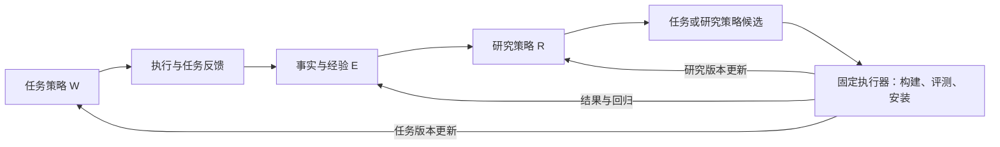

# ouroloop 设计（v0.5）

> 2026-09-27。目标：以可学习的决策策略为核心，构建任务能力与研究能力都可持续更新的 RSI 框架。AutomationBench 是首个证明场。
> 本文区分目标与实现：**已建**有代码，**改造**扩展现有模块，**新建**尚未实现。新增设计没有新增实测收益。
> 实施见 [ROADMAP.md](ROADMAP.md)，研究协议见 [RESEARCH_AGENT.md](RESEARCH_AGENT.md)，演示见 [DEMO.md](DEMO.md)，历史证据见 [JOURNAL.md](JOURNAL.md)。
> 本版审查见 [RSI_REVIEW.md](RSI_REVIEW.md)；开发交接从 [模块详细设计](modules/README.md)开始，跨模块字段以 [公共契约](modules/00_CONTRACTS.md)为准。

## 0. 定位、目标与当前证据

ouroloop 把 agent 执行和研究中的反复判断，变成可观察、可修改、可训练、可验证和可继承的策略。系统从任务与实验反馈中修改这些策略，让更新后的能力参与后续任务和后续改进。

独特的研究方向是**将反复发生、依赖上下文的判断学成小决策模型**，与 prompt、规则和工作流共用决策接口。模型的产出不只是分数，而是实际控制 agent 行为、可加载和可回退的策略。模型是否保留，由完整任务质量与总成本决定；不为每个业务训练一套专家模型。

完整目标有两部分：

- **任务能力改进：** 执行任务 → 发现行为缺口 → 修改策略或训练 → 评测 → 安装 → 用新版本执行。
- **研究能力改进：** 观察上述实验过程 → 发现研究方法的缺口 → 修改研究策略 → 比较后续改进效果 → 安装 → 用新方法继续研究。

首个业务验证是 AutomationBench Marketing：以完整任务通过率、成本和延迟，与领先模型及同底座起点比较。外部能力参照仍是业界领先模型；借鉴的框架仅作为设计来源，不设框架排行榜。

**当前代码基础：** 决策层、账本、训练器、作业、模型库、服务、版本和独立研究候选循环已有实现。M1 已在真实上游 checkout 验证运行契约；M3 已有完成度探针及脚本模型的离线干预检查。**尚无真实模型的业务成绩、完整任务晋升闭环、集成研究循环或研究策略自更新。** 实现和历史测量细节保留在路线图；本版不重做已完成部分。

## 1. RSI 定义与系统边界

### 1.1 什么被改进，什么参与下一轮

本项目采用系统层 RSI 定义：系统根据执行与评估反馈，持久修改自身完成任务和开展改进的方法，经验证后采用，并让新能力参与后续改进。它不要求每轮训练权重，也不要求改写基础模型。

系统状态可简记为 `S = (W, R, E; K)`：

| 部分 | 内容 | 谁可以改变 |
|---|---|---|
| W：任务策略版本 | agent 的 prompt、工作流、决策输入、规则、小模型及默认策略 | 研究员提出候选，固定执行器验证后更新 |
| R：研究策略版本 | 诊断提示、证据检索、候选选择、实验步骤、研究用检查或决策策略 | 同一提案接口提出 research 候选，经独立运行的比较后更新 |
| E：经验记录 | 正负结果、行为缺口、机制活动、版本适用范围、研究经验 | 框架追加事实；研究员可提出有来源的摘要与检索策略 |
| K：实验内固定核心 | 评分器、数据边界、权限、预算上限、裁决规则、记录与版本更新代码 | 不属于自动改进对象；人工变更后建立新实验身份 |

W、R 都是策略集合，E 是可追溯经验，K 保证比较仍有意义。允许 R 改诊断或验证辅助工具，不允许它改判定成功的官方评分器或自己的晋升标准。

目标结构如下；任务和研究候选经过同一条验证与发布路径，当前尚未全部接通。

### 1.2 三种可声明的结果

| 层次 | 必须看到的证据 |
|---|---|
| 迭代优化 | 根据结果产生并评测新候选 |
| 系统自我改进 | 候选成为持久运行版本，后续任务实际使用它 |
| 递归改进 | 经验证的新研究能力进入下一轮研究；进一步的效率或质量收益由 C4 支持 |

“运行了很多轮”“写了新 prompt”“训练了一个模型”都不是递归收益的充分证据。经验增长也不自动代表研究能力变强。完整框架要支持第三条路径，实际收益按证据声明，不承诺持续加速、逐代单调或无界进步。

研究能力的更新可以是更好的诊断流程、经验检索或候选验证程序，不必另训一个研究员模型。业务用的小模型也只有在输入、标签和动作语义适用时才可用于研究，不能把“任务是否完成”的模型直接当“实验是否有效”的裁判。

### 1.3 第一性原理

- 目标是完整任务效果；局部准确率、训练 loss 和机制触发率解释原因，不替代结果。
- 先找行为缺口，再选载体。明确条件用规则，流程遗漏用 prompt/workflow；有可学习结构和收益空间才训练。
- 决策时不可见的信息不能进入策略输入；最终得分不能自动变成全部中间动作的标签。
- 改动必须真正执行。比较提案、装配事实和实际动作，区分未触发、触发无效及产生回归。
- 策略会改变后续状态；离线拟合要经真实执行复验。
- 同一套候选与版本机制服务 W 和 R；不为递归再建一套调度平台。
- 第一条业务线只接一个域、一个决策点、一个可训练模型；接口完整不等于首次实验启用所有能力。

## 2. 可改进的策略与统一接口

### 2.1 按行为职责定位改动

| 决策职责 | 可以改什么 | 在现有项目中的落点 |
|---|---|---|
| 信息与经验 | 当时看什么、如何整理上下文、检索哪些已获准经验 | point view、compact、研究 Context |
| 规划与流程 | 步骤顺序、何时补充查询、何时验证或重试 | harness prompt、workflow、retry |
| 能力使用 | 在固定权限内选择模型、工具及已有技能 | route、tool_gate、providers、工具适配 |
| 动作与完成 | 放行、打回、继续、结束或回退 | policy、StopGuard、执行 hooks |

这是改动分类，不是四个新服务。第一处业务接点仍是 `stop/on_finish`；其余职责逐步映射到现有扩展点，不要求重建 agent 或多 agent 平台。

### 2.2 策略的载体

一次策略更新可以修改 prompt、规则、工作流、输入表示或模型。拟建统一策略描述包含：

`owner(worker|research), target, binding, input_schema, output_schema, implementation, applicability, fallback, limits, evidence_refs`，并带 schema 版本。

`binding` 区分 decision、config、research_step：只有 decision 输出有限动作，配置和研究步骤各有输出 schema。implementation 指向不可变 prompt、已注册规则/工作流配置或模型引用。运行时绑定到真实执行位置，不依赖 agent 偶然调用某个“决策工具”。合法策略运行中的不适用、弃权或暂时调用失败采用声明回退；artifact/schema 不匹配则构建或安装失败，不能静默替换后声称候选通过。

现有 Candidate 的 spec/recipe/prompt 表示改动载体，owner 表示改 W 还是 R，二者分开。第一版仅开放声明式配置及已有可信执行函数；不执行生成的 Python、动态 import 或任意仓库补丁。策略源码生成须另行交付文件、网络和进程隔离，不是闭合 RSI 的前置要求。目标、绑定位置与动作语义见 [策略运行设计](modules/01_POLICY_RUNTIME.md)。

| 部分 | 实验约束 |
|---|---|
| 基础模型 | 启动时固定底座、effort、fallback 与采样；路由仅使用预先声明的小集合 |
| 工具 | 工具语义、权限和外部信息来源固定；可改变合法使用顺序或增加基于已有证据的检查 |
| 小模型 | 一个模型或适配器起步；固定规模、上下文与训练预算，复用 trainer 插件 |
| 研究策略 | M5 固定 R，M7 开放有限 R 目标；候选不能在评测中改自己的版本 |
| 领域能力 | 可使用已声明固定工具；不自动扩建领域专家池 |
| 评分与数据 | K 冻结；改标签语义须重建数据，不能重新解释评分来制造收益 |

同一假设可包含多个必要改动，不强制一轮只改一个键或必须训练。提出某个组件的贡献主张时才补相应对照。

冷启动可根据任务说明、已有流程与合法材料生成初始 W 和固定 R0，先校验再运行基线。此时没有执行经验，资料定制不能被称为已验证的改进；首次运行后才形成反馈驱动的候选。材料不足时补充可见输入，不强迫训练。

## 3. Benchmark 与领先模型比较协议

### 3.1 数据、划分与可见性

[AutomationBench 官方仓库](https://github.com/zapier/AutomationBench)提供业务模拟环境和公开任务；本地公开任务与[官方榜单](https://zapier.com/benchmarks)的私有任务集不同。本地分数不能直接用于宣称超过官方榜单。

1. 固定上游 commit、依赖锁、任务文件摘要、工具模式、步骤上限和评分器版本。先 Marketing，其他域随后进入独立实验。
2. 首次观察结果前，按任务或工作流家族固定 `train / dev / test` manifest。变体、同任务的全部轨迹、分支、重复尝试和标签属于同一组；随机种子或 session ID 不构成新任务。
3. train 用于采集和训练；dev 用于诊断、prompt 搜索、选模型和候选晋升；test 只用于锁定最终版本后的报告。训练池内部再按任务组划分 checkpoint 验证及必要的校准数据。
4. 先记录实际分组数量和区间宽度，再判断可支持的主张。小样本可报告探索性结果，不能用同任务重复次数伪装独立任务数量。
5. 研究员只看 train/dev 证据。执行 agent 只看任务和合法工具返回，不看评分断言、参考答案、未来状态或离线分支结果。
6. 公开测试可下载，因此隔离指本实验的访问与调优协议，不承诺基础模型预训练未接触过这些内容。

test 不参与继续迭代、挑种子、挑最好一代或发布与否的筛选。根据其结果修改方案后，该池转为开发资料；新的泛化结论需要新的独立任务。每代曲线来自 dev，最终测试单独显示。

### 3.2 比较对象

外部能力参照是**业界领先模型**。实验开始时，依据目标域的官方结果选择至少两家供应商的领先模型，记录日期、来源与实际可调用的模型 ID。2026-09-27 官方 Marketing 页面列出的候选包括 GPT 6 Astra（Max）与 Claude Opus 5.5（default fallbacks, Max）；这是候选选择快照，启动时重新核验，不把官方私有分数写成本地成绩。

领先模型也通过同一个任务驱动器运行，获得完整说明、正常工具发现方式及各自支持的合理提示格式，不故意削弱基线。fallback 要显式配置并计入全部模型成本；无法复现官方 fallback 时另行命名。模型不可用时记录缺席，不能悄悄换成弱版本。

| 版本 | 目的 | 最小要求 |
|---|---|---|
| `frontier_a / frontier_b` | 最终能力相对领先模型的位置 | 相同任务、工具、评分器；公布模型、effort、预算、fallback |
| `base` | 判断整套迭代是否有效 | 目标底座的合理初始 agent，不刻意设置弱 prompt |
| `prompt_best` | 判断训练是否值得 | 同一目标底座，允许预算内已优化的 prompt/workflow，不启用学习得到的决策器 |
| `evolved` | 最终方案 | 开发阶段锁定的完整版本，记录全部优化与训练支出 |

`base` 与 `prompt_best` 无差异时可复用。同底座比较固定模型、effort、工具权限和每任务资源上限。检验小模型增量时使用同一最终 prompt/workflow，将决策器替换为声明的默认策略；若这就是 `prompt_best`，直接复用，否则只在提出小模型贡献主张时补这一对照。预算上限一致，实际花费差异照实报告。

跨模型报告两种视角：相同工具和步骤上限下的任务能力，以及预先声明费用上限下的质量—成本取舍。不同 tokenizer、缓存和计费方式导致 token 数不能简单等价。领先模型在费用上限内没有可运行配置时，报告缺口并展示正常配置的能力和成本，不能将其记成失败制造胜出。

### 3.3 指标与结论

- **主指标：完整任务通过率 `task_completed_correctly`。** 保持官方断言和评分语义。
- **辅助指标：`partial_credit`、错误类型、约束违反次数。** 部分完成率不能称为任务成功率。
- **运行成本：** 主模型、fallback、决策模型、特征准备、额外验证和重试的全部开销；另报延迟、工具次数、预算耗尽。
- **改进成本：** 数据生成、离线分支、研究员、训练、开发评测与无效作业。报告累计值；摊销时公开任务量假设，未测费用标记缺失，不能视为零。
- **统计：** 预先固定重复次数、比较对象和主要结论。按任务聚合重复运行，配对比较；有家族依赖时按家族重采样。报告差值与区间，中途增加实验次数要记录。

“能力更强”要求预先指定的完整任务通过率比较有支持；“更经济”要求质量满足预先声明的非劣界限且成本降低。“差异不显著”不等于同等质量。达不到就报告未证实或仍落后，不承诺必须赢、不预填分数、不换指标补结论。

任务层三项证据分别记录：**C1 迭代相对同底座起点的收益；C2 相对领先模型的能力或成本位置；C3 小决策模型相对同配置默认策略的增量价值，以及是否值得替代 prompt_best。** C2 单独成立不足以证明迭代有效；C1 成立而 C3 不成立时，只能证明整体优化有效。只关闭决策器能衡量它在当前配置中的贡献，但不能把一份较弱 prompt 上的收益说成优于已有最佳 prompt 方案。

**C4 研究能力改进**单独验证：在相同起点、可见经验与研究预算下，更新后的研究策略能否产出更好的任务策略，或用更少成本达到预设质量。它不由 C1 自动推出；协议见 §6。首个业务报告可以先发布 C1～C3，完整 RSI 框架还须交付研究策略更新及回用路径。

## 4. 从反馈到可继承策略

### 4.1 行为要求先于实现方案

反馈先整理成一个有证据的行为缺口：

`context, expected_behavior, observed_behavior, evidence_refs, acceptance, recurrence, status`。

例如“agent 宣称完成，但任务要求的后续操作没有执行”是行为描述；“必须训练分类器”是待检验的实现方案。expected_behavior 来自任务、合法业务材料或已登记要求，不由研究员凭空扩大任务范围。LLM 的解释保留为假设。

反馈来源可以是环境评分、真实用户意见或执行记录；来源分别保留。反馈整理负责区分行为问题、缺材料、运行故障及已解决要求；策略设计负责选择改什么。它们是同一个研究步骤中的逻辑阶段，默认不增加独立 Analyst agent。

M1 中多个断言必须同时满足的测量支持“遗漏检查值得研究”；它不能证明真实 agent 的主要失败原因，也不能证明局部可见信息足够训练完成判断。M2 用真实轨迹验证，M3 的脚本干预只证明机制可改变执行。

### 4.2 三种数据不能混用

| 数据 | 用途 | 可否直接进入现有监督训练 |
|---|---|---|
| 当时观察、动作、工具结果、模型与版本 | 重建过程、构建输入 | 没有标签时不能 |
| 最终通过率、部分完成率、用量 | 评价完整方案、诊断失败 | 不能展开为每一步的正确标签 |
| 对特定决策有依据的动作标签或偏好 | 训练决策模型 | 经过来源、语义、分组与噪声检查后可以 |

当前 `ledger.Row.target` 和 `evolve/build.py` 接受候选标签分布。完成度反馈已有 `CompletionProbe` 实现，其余决策点仍需各自的反馈构造器；不能把任务 reward 改名为 label。样本保存决策前输入、候选、动作、来源任务组、策略版本、反馈证据与信号生成版本。

优先支持两条信号路径：

1. **局部可核验结果。** 对训练任务的隔离状态事后检查是否满足完成条件。训练的是完成判断，不是“继续一定有收益”的真值；最终评测任务的在线执行不能得到此类评分反馈。
2. **有限分支比较。** 在训练任务的同一决策前状态尝试少量替代动作，用固定后续策略、剩余预算及预定重复次数执行到底，比较完整结果与成本。环境无克隆接口时，先验证 reset 加动作前缀重放可重建同一状态；不等价重放不能当配对证据。差异不明确时弃权或保留不确定性，不把一次偶然成功当永久正确标签。

分支标签依赖后续模型、prompt 与预算，条件变更后须重验适用性。分支成本计入改进预算。标签来自隔离环境观测或人；LLM 可提诊断与候选，但其自评、参考轨迹相似度、晋升结论都不直接作为业务动作真值。保留现有 `env/human` 与 `EVAL_ONLY` 区分。

最终 reward 直接驱动策略梯度属于另一种训练契约，第一版不引入。无法形成有用信号时保留有效 prompt、换干预点或报告假设失败，不能用扩大模型规模掩盖信号缺口。

当前完成度探针只在 train 挂载：决策时保存环境快照，运行结束后用官方 rubric 为该快照标记完成与否。环境快照和断言只供离线标注，模型输入仍只能来自当时合法可见的任务与工具证据。部分断言得分可供开发诊断，但不能作为最终任务的在线提示。

### 4.3 一轮任务改进

1. 固定当前 W、R、可见经验 E 的版本与预算；当前 W 在 train 执行并采集。
2. 检查实际装配：加载了什么策略、输入字段是否存在、由谁决定动作、哪些默认或规则覆盖了模型。
3. R 从 train/dev 结果生成行为缺口，检索有关成功、失败和回归，提出一个候选或明确的下一步：继续采集、补材料、修复运行问题、停止。
4. 准入后冻结候选、反馈构造器、数据和开发评测计划。先做 schema、加载、输入可用性和动作合法性检查；不存在可靠标签则不进入监督训练。
5. 需要时复用 build/check/train/store/serve；否则构建 prompt、规则或 workflow 策略。
6. 在开发任务小集合做机制检查和廉价筛选：目标失败、原本成功的回归任务都覆盖。弱证据不直接判改善；通过者运行预定完整 dev 集。
7. 固定评测器决定接受、拒绝或 inconclusive。完整版本先在隔离 runtime 装配，通过后更新指针；失败保留旧版本。
8. 写入行为是否改变、目标问题是否解决、新回归、实际支出与证据。下一轮使用被接受版本，读取更新后的经验。

候选进度、评测结论与安装结果分开：accepted 不等于 installed，安装还可能 installation_failed 或 stale_parent；完整状态机及恢复规则见 [执行与预算](modules/05_EXECUTION_BUDGET.md)。未触发是诊断字段，不一律判失败：某策略在特定任务本来就不该触发。触发一次也不构成因果贡献证明。

开发搜索结束后才执行预定 test 活动。小集合均值不能与完整集合均值比较选冠军，test 不用于诊断和下一轮修改。

### 4.4 经验怎样继承

原始记录只追加；摘要与索引带版本并引用原始证据。经验条目记录问题、情境、假设、尝试、实际触发、完整任务结果、支出、适用版本和反例。检索先用已有标签和过滤，不先建向量库。

后续研究同时查看修好的问题、仍失败的问题和新引入的回归。输入、模型或工作流变化使经验不再适用时标记过期，保留旧记录。不能仅凭“这轮晋升了”生成所有动作正确的标签。

实验结束，交付的是可再次加载的 W、R 及可携带的经验索引，不只是某次会话的反思文字。对外共享时分别标明具体业务材料与可复用策略，不能把训练题答案包装成一般能力。

## 5. 结构与代码落点

保持现有执行与训练骨架。以下路径除显式前缀外均相对 `ouroloop/`；新文件是目标设计。

| 模块 | 职责与状态 |
|---|---|
| `benchmark.py`、`bench.py`、`adapters/automationbench.py` | 已建 M1：运行契约、工具、评分、快照；M3 完成度探针已建；其他反馈及 phase 待接 |
| `agent/`、`providers/`、`decision.py`、`runtime.py` | 已有执行与类型化决策；扩展 W/R 的策略身份和机制活动 |
| `policy.py`、`stop.py` | 已有动作与回退；保留 on_finish，核对实际执行和预算 |
| `evolve/contracts.py`（新建） | 策略、实验、证据、评测与安装的公共类型及版本兼容 |
| `policies.py`（新建） | 薄策略描述与已注册目标，接 Candidate；不建立第二个执行器 |
| `research/inspection.py`（新建） | 从实际 runtime 读取生效策略、输入覆盖和执行证据，产出允许公开的快照 |
| `ledger.py`、`evolve/experience.py` | 复用追加记录，扩行为缺口、激活、回归、W/R 身份和经验索引 |
| `evolve/build.py`、`evolve/checks.py`、`evolve/train.py`、`trainers/`、`worker.py`、`stores/`、`serving.py` | 复用监督数据、作业与服务；扩任务组划分、反馈版本和真实成本 |
| `research/agent.py`、`research/basic.py`、`research/loop.py` | 保留入口；逻辑上先诊断再设计，worker/research 候选共用 |
| `research/experiment.py`、`research/context.py`（新建） | 薄实验记录、候选 owner、只读可见证据和提案校验 |
| `evolve/plan.py`、`evolve/pipeline.py`、`evolve/harness.py` | 准入、可选训练、构建与评测；现有模型路径仍主要是标签 replay |
| `evolve/task_eval.py`、`evolve/task_gate.py`（后者新建） | 已建单候选运行；扩配对、筛选和完整任务裁决，保留原 decision 门 |
| `research/campaign.py`（新建） | M7 复用任务改进循环比较两个 R，不另建训练平台 |
| `evolve/gate.py`、`evolve/registry.py`、`release.py` | 复用裁决与版本；区分 decision/task/research 评测类型，扩完整策略引用 |
| `evolve/execution.py`（新建）、`generations.py` | 薄状态/预算记录与共用调度连接采集、研究、训练、评测、安装；游戏路径保留 |
| `report.py`、`cli.py`、`examples/automationbench/` | smoke 已建；其余入口、报告、回放和研究比较未建 |

### 5.1 最小契约与版本

任务结果沿用 `TaskResult`；目标上补齐与行为缺口、反馈、W/R 和经验版本的关联。策略描述、Requirement、Experiment、经验条目作为现有记录的有类型载荷，不引入四套独立数据库。

一次运行固定完整 manifest：基础模型与推理参数、W、R、经验快照、环境/工具/评分版本、数据划分、反馈构造器和预算。`RunManifest v2` 增加上述引用，同时保持旧运行及其 hash 可读。旧发布三元组与 decision profile 保留；新 task/research profile 使用完整 `SystemRelease` 和专用授权凭据，不能伪造旧 GateRecord 放行。

安装以完整策略集合为单位；输入规格、模型、prompt 与默认策略共同冻结。新 profile 只读一个完整 W/R 的 active 指针，先检查装配，再按父版本和 revision 做 CAS；旧模型冠军不能与之混装。运行中会话 pin 原版本，撤销后按固定默认或中止策略处理。提交前后崩溃、安装失败与父版本过期分别恢复；详见 [评测与发布](modules/03_EVALUATION_RELEASE.md)。缓存只复用身份和协议都相同的结果，状态不明的付费调用保留预算占用。

worker 候选只替换 W，research 候选只替换 R，并保留另一方的明确版本引用。研究比较分支产生的 W 是评价研究方法的产物，不自动覆盖主线 W；若要采用，仍须走对应任务策略的安装协议。

### 5.2 现有机制的处理

- `stop.py` 带 checker 的 on_finish 路径由 checker 决定；业务 benchmark 不接隐藏评分器作在线 checker。记录提出动作、最终动作、执行者与覆盖原因。
- 现有校准与 session 风险机制不构成“业务失败率最多 5%”的保证。task/research 评测不伪造局部标签通过旧门；原 decision profile 的约束和回归检查保留。
- 模型自报完成、预算耗尽、错误操作属于有效任务结果。基础设施无效尝试按固定规则记录和补跑；候选代码本身的逻辑错误属于候选缺陷，不能无限作为基础设施故障重试。
- 模拟操作作用于隔离数据；真实业务部署需另验证权限、反馈、分布和回退。
- 研究提案、候选策略和实际运行可读资源分开配置。序列化 Context 或去掉答案字段不是进程隔离的替代品；首版没有生成代码的执行权限。
- 现有 stop 输入只取任务前 300 字符、文件与简短动作，业务 view 必须另存当时任务/工具证据并显式记录截断；信息不足不能靠训练补出不可见事实。
- task 数据按任务家族切内部训练/验证，历史输入只从当时合法 observation 重渲染；从 prepare_model 抽出无晋升副作用的训练构建，详见 [证据与训练](modules/02_EVIDENCE_TRAINING.md)。
- 开发接受用于选择下一轮版本，不代表统计显著提升；固定完整评测与最终独立证据分别报告，具体裁决与错误分类见评测模块。

### 5.3 接入其他 agent 或业务环境

框架不要求更换宿主的执行循环。一个适配器显式声明可读状态、可控决策点、可修改策略目标及可获得反馈；首先接内置 agent，其他 harness 按能力接入。

| 最小契约 | 作用 |
|---|---|
| inspect | 读取实际装配的策略与配置，过滤出研究员可见的部分 |
| run / observe | 执行任务，记录当时观察、动作路线、结果与用量 |
| feedback | 提供有来源的任务结果或局部标签；未知、延迟与冲突单独记录 |
| evaluate | 在固定环境与协议下评价候选，评分资源不作为在线工具暴露 |
| validate / install | 校验并加载完整策略引用；支持何种目标由宿主声明 |

这些是现有 runtime、任务适配器与评测器的职责契约，不要求实现五个独立服务。宿主只能输出日志而不能控制决策时，只提供观察和离线研究；不能宣称已形成自动改进闭环。真实业务反馈可能延迟或缺失，不因有一条轨迹就立即生成训练标签。

## 6. 研究能力怎样递归更新

### 6.1 同一个框架，另一种改进对象

M5 先用固定 R 完成任务改进。M7 将 R 的有限部分注册成可改目标：诊断 prompt、经验检索规则、候选优先顺序、实验工作流及辅助检查。基础研究模型保持固定；训练研究用小模型是后续可选实现，不是递归的必要条件。

具体例子（目标设计）：记录显示多次训练无效源于决策输入缺少任务要求。R 提议在训练前检查“任务要求与已执行证据是否进入 view”，把检查及诊断步骤作为 research 候选。它只能检查输入充分性和构造证据，不能查看最终测试答案或修改验收标准。

当前 R 提议 R'，固定 K 在两个隔离分支评测；评测期间各分支的 R 不再自修改。通过后才在下一轮使用 R' 提出 worker 候选。记录 `R0 → R1 → R1 产生 W2` 的来源链。调用自己更新后的研究流程，构成明确的递归路径。

### 6.2 比较研究策略，避免“自评变强”

一次研究比较单元称为 campaign：给定初始 W、同一份起始经验、同一训练/开发任务池和总预算，运行若干完整改进轮次，输出一个按开发协议选定的 W 及全部费用。

- 比较 R 与 R' 时使用相同起点、证据、预算和模型设置；两支的新经验互不传递。共享的是相同初始经验，不能用“新研究员多看了历史”充当策略收益。
- 内部任务改进只看本 campaign 的 train/dev。外部研究评估使用另行保留的任务组，结果不进入内部选 W 的过程。反复用来挑 R 的外部结果也属于研究开发数据，不能再称独立测试。
- 初期可在现有 train/dev 内预先划出少量研究比较分组，不改已冻结的 test 归属。初始 W 的训练来源与经验 E 也须按分组核验；已经进入历史的任务不能靠重新命名恢复独立性。数据不足以支持独立 campaigns 时只报告工程验证。
- C4 正式结论需要预先冻结 R/R'、campaign 起点、重复次数和新的独立任务组；按配对 campaign 报告结果。若 M6 的 test 已被看过，不将它重用于 M7 调优后的独立证明。可先完成 M7 开发，再统一运行一次最终报告。
- 主判据是**同研究预算下产生的 W 的任务质量**，或**达到预设质量需要的全部研究成本**。接受率、提案数量和少跑实验仅作诊断；达不到目标也要计入。
- 人工给出的研究改动可验证接口，但只有系统根据记录提出、验证并回用的改动才能作为自动递归实例。

研究候选的正式裁决由固定执行器完成，不让被评研究员写自己的得分。M7 复用候选、账本、worker 评测和发布接口，只增加“运行一个短改进过程”的评测方式。可执行的 CampaignPlan、内外层权限、独立统计单位、W* 选择、失败分支与实际 R1→W2 回用见 [研究策略评测](modules/06_RESEARCH_CAMPAIGN.md)。

### 6.3 预算与停止

每个实验预设候选数、轮数、训练次数、分支数、模型规模与单次/累计费用和时间上限。研究比较两支及其嵌套任务运行都从总账扣除；不允许每进入一层重置预算。费用在调用前保守预留、结束后按实测结算，未知调用仍占额度；无法约束计费上界时不能声明严格美元预算。重试和取消后的已发生费用同样计入。

无收益耐心、无可执行提案、基础设施连续失败和总预算耗尽均有固定停止规则。最后一轮没有验证预算时不安装新策略；允许输出未评测提案，但不能称最终改进。

第一版只允许 worker 与 research 两种 owner，研究候选评测期间冻结自身，不构造无限元研究层。默认一轮一个候选；有具体需要才扩少量备选。先做加载/机制检查，再付完整任务费用；不强制大规模消融、候选树、专家池或实时平台。

## 7. 交付与验收

完整框架的工程交付包括：

1. 环境与反馈适配、类型化策略接口、实际运行检查。
2. 行为缺口 → 可执行候选 → 可选训练 → 完整任务评测 → 完整版本安装。
3. 正负经验继承、回归证据和可恢复的预算记录。
4. research 候选经比较后回用到下一次改进；不是只有 worker 更新。
5. 固定配置、机器可读结果、候选差异、模型与策略说明、复现入口。

[集成验收](modules/08_INTEGRATION_CASES.md)给出不训练、训练、R 回用、安装恢复、权限、总预算与最终报告七条跨模块场景；模块用例和实现所有权从 [开发入口](modules/README.md)查找。

分阶段报告证据：M6 的 C1～C3 回答任务收益、领先模型位置与小模型价值；M7 的 C4 回答研究方法是否变好。工程完整与四项主张获得支持是不同状态；任何一项未证实都如实报告。

首个演示串起“同类遗漏 → 新策略阻止遗漏 → 新任务结果”，再展示“研究过程的缺陷 → 新研究策略 → 下一轮实际采用”。游戏仍只作 smoke；基准成绩始终与领先模型比较，不用架构复杂度或跨框架功能数量代替效果。

## 8. 设计来源与取舍

- [Raven Curator](https://github.com/EverMind-AI/Raven/blob/40a6b456dcd13f9c551a0f78dc1361e55b90e4e4/experimental/docs/design.md)：借鉴实际装配检查、可替换策略和校验后安装；按现有决策接口落地，不引入多层 agent 组织。
- [Raven 反馈迭代](https://github.com/EverMind-AI/Raven/blob/40a6b456dcd13f9c551a0f78dc1361e55b90e4e4/experimental/docs/rsi-iteration.md)：借鉴行为要求、机制活动和跨轮反馈；诊断与设计作为逻辑阶段，不增加独立角色服务。
- [Raven 研究实现映射](https://github.com/EverMind-AI/Raven/blob/40a6b456dcd13f9c551a0f78dc1361e55b90e4e4/docs/specs/self-evolution-loop-raven-mapping.md)：借鉴廉价筛选、失败与回归记忆；不照搬候选树与多门数量。
- [Darwin Gödel Machine](https://sakana.ai/dgm/)：系统的可执行能力可以参与后续自改进；据此明确 R 的更新与回用，不把递归限定为训练模型。
- [AutomationBench](https://github.com/zapier/AutomationBench)与[官方榜单](https://zapier.com/benchmarks)：首个任务环境、固定评分和领先模型选择。
- [RouteLLM](https://arxiv.org/abs/2406.18665)、[Budget-Aware Agentic Routing](https://arxiv.org/abs/2602.21227)：有限决策的学习路径；本项目其他决策仍需独立证据。
- [GEPA](https://arxiv.org/abs/2507.19457)：反馈直接优化 prompt 的路径；小模型须与有效的非训练方案比较。

本项目的区别落实为：以类型化决策为改进单元，规则/prompt/模型可替换，训练与运行共用证据链，W 与 R 共用更新机制，并分别验证任务能力和研究能力。上述是设计选择，不是已经领先的实测结论。
