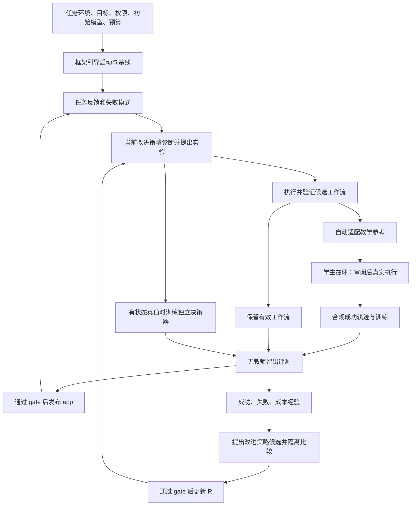

# ouroloop 设计（v0.7）

> 2026-10-04，v0.7：首版交付物从“固定 agent 循环 + 能力包”改为“**可演化的 agent 程序 + 最小运行壳 + 所 pin 的模型**”。原因：v0.1/v0.2 两次安装的改动都是文字提醒（[RESULTS](RESULTS.md)）；剩下的失败主要是判断错误与未读状态，这类失败只有循环层的机制（核验回合、判断前的证据表、以工具取事实、以算力换准确）才触及得到；Harness-Zero 固定循环是因为它的学生要被训练，而训练已移到第二版；业界报告较大留出增益的框架（StarHarness 在 AutomationBench Finance 留出 +29.3，AutoSaddler +9～10）都在改循环与工具（[SURVEY_RSI_FRAMEWORKS](SURVEY_RSI_FRAMEWORKS.md) §4、§6）。随之改写 §1、§3、§5、§7、§8、§9；§2、§4、§6 保留原文，§2 只加一条口径注、§6 只加一条 v0.3 注。新增或改动的规则都标“（v0.3，2026-10-04）”；v0.1/v0.2 的结果与记录不删。同日按“先剪再做”的原则剪过一轮：考虑过而不做的项与推迟到第二版的项各列一份清单在 §9。
> 2026-09-28，按确认后的产品定位修订：交付能够依据任务反馈改进自身的 agent 应用，以及产生、验证和持续更新这个应用的框架。首版保留完整的最小 RSI 闭环，以实现范围控制复杂度。
> 本文是开发目标。代码基线为 `b1cb7a7`；2026-09-30 调整交付顺序：首版交付受限的 harness 代码演化、独立部署与递归回用；第二版完善教学适配和模型训练。首版（阶段 A～E）的工程链路已实现并经离线 fixture 验证。真实模型跑到过一次 dev gate（2026-10-01），因供应商余额耗尽判 inconclusive；2026-10-02 复核发现 4 个高危缺陷，修复后进入付费运行（[ROADMAP §3](ROADMAP.md) 首个真实活动协议）。2026-10-04 已有两个完整活动的密封 final：v0.1 同模型 +13.0 [+2.2, +26.1]，v0.2 +4.3 [−10.9, +19.6]，C4 无证据（[RESULTS](RESULTS.md)）。第二版能力未实现。已有实现及实测见 [历史快照](history/V0_5_IMPLEMENTATION.md)和 [JOURNAL](JOURNAL.md)。
> 开发入口：[ROADMAP](ROADMAP.md) → [技术选型](TECHNOLOGY.md) → [模块设计](modules/README.md)。公共字段以 [M0](modules/00_CONTRACTS.md)为准。

## 1. 最终做出来是什么

ouroloop 让一个 agent 应用从任务经验中发现更有效的方法，验证这些方法，将值得保留的能力固化到 agent 程序、执行模型或决策模型，再让已验证的改进参与后续改进。首版交付物是三件（v0.3，2026-10-04）：**一个可演化的 agent 程序**（能力包，循环本身也在包里）、**一个最小运行壳**（runner shell；宿主：模型网关、工具 broker、权限、硬限额与记录）和**所 pin 的模型**（身份与推理配置上限），以及证明它为什么值得采用的实验记录。此前首版把 agent 循环固定在宿主里，包只提供 memory/skills/hooks/tools；改的原因见页首。

用户给出任务环境、目标与验收方式、允许的工具和权限、初始模型、可用训练资源和预算。框架提供初始 agent 程序（默认 agent，即今天的宿主循环移植成包）、默认改进策略、经过能力检查的训练配方；从真实运行失败开始自动提出并试验改进。用户不必先写好优化后的工作流，也不必每轮选择训练方法或超参数。用户仍决定业务目标、资源和权限，框架不能从任务日志可靠推导这些授权。

以“更新记录并通知”为例：初始 agent 漏通知 → 框架从任务反馈定位遗漏 → 候选可以是一个查询/更新/确认的工具封装，也可以是判断前先列出证据表的循环改动、发送前的二次核验回合，或在 K 的 effort 上限内对关键决策多采样 → 隔离检查并在失败过的 train 题上先筛 → 在固定 dev 清单上与当前版本的合并对照比较效果、退化与成本，再确认一次 → 按冻结门槛发布新 app。下一轮使用新程序继续发现失败；改进策略本身若反复选错实验，也作为候选被验证和更新，下一次真实改进调用加载更新后的策略。第二版再将值得固化的方法采集为学生的训练数据。

用户最终看到三样东西：可部署 app（agent 包 + 运行壳 + 模型服务描述，M3 §4）、包含成功与失败的质量/成本报告（每次有效尝试的成本 `cost_per_attempt`、实验账目、研究位的剩余空间、按领域分列，§8）、可继续演化的工作区。部署端只需要运行依赖；改进工作区保存研究、训练及实验材料。多个业务流程可以分别发布 app，不需要先建设应用商店服务。

## 2. 解决什么问题，怎样才算有效

agent 的失败可能来自领域推理、工作流顺序、工具使用或完成判断。只改 prompt、只训练领域模型、只加一个决策器都可能有效，但没有一种手段天然适合全部问题。实际缺口是：**从失败反馈找到有效方法，将它变成部署时可执行的能力，并用一致的评测决定是否采用，往往是断开的。** ouroloop 把这条链打通，并把改进方法也纳入可检验的版本循环。

小模型的价值是有条件的：在目标任务上复现有效行为，降低部署开销，或提高决策稳定性。如果 prompt/规则已经满足质量和成本要求，框架可以直接保留它，不强制训练。训练是否值得取决于无教师任务结果及总成本，不能用 loss 下降、模型更小或模型数量证明。

首个证明场是 AutomationBench Marketing。首版 actor 原定 GLM-5.3（已配置并计价的 OpenAI 兼容接口；2026-10-03 起先跑 Claude Opus 5.5，见 ROADMAP §3 第 2a 步），冻结其底座、权重身份和推理配置，比较起点、有效 prompt/workflow 与自动演化的能力包；第二版换 Qwen3.5-9B 学生时，h* 须在学生上重新演化（Harness-Zero 的 h* 在学生上验证，其 base+h* 是学生带 h* 的成绩），再比较蒸馏 app；独立决策模型的贡献另用同 actor 比较（v0.3 起读作“同模型”，§3）。领先模型沿用既定选择：默认引用其已公布结果作为外部背景，不自行启动付费复测。首要目标是整体有效，不建设拆尽每个组件贡献的消融平台；对某组件作独立贡献主张时才要求相应对照。

当前证据：v0.5 的策略、训练作业、配对评测、发布、预算与研究回用已有离线工程验证；GLM-5.3 在 2026-09-28 完成一个 Marketing dev 任务。2026-10-01 有两次真实运行：一次把失败的 train 任务从逐题笔记、汇总、草稿检查与一次修订、准入、冻结实验走到构建候选，在 gate 前有意停止；另一次的草稿首检即通过，经筛选走到一次 dev gate，gate 因余额耗尽判 inconclusive，未安装。**这些都不是通过率，没有证明训练或递归改进收益。** 本版设计也不是新增实验结果。

## 3. 框架能力、实验约束与首条实现路径

| 层次 | 应当明确的约束 | 含义 |
|---|---|---|
| 框架 | 可版本化的 agent 程序、改进策略、经验和固定验收核心（v0.3） | 目标是能力的发现、验证、固化、递归回用；不以某个模型或训练算法定义框架 |
| 单次实验 | 冻结起点、任务、模型身份、候选变更、预算和比较协议 | 保证结果可归因、可复现；换工具/底座/运行壳要创建新实验身份（v0.3） |
| 单次蒸馏 | 固定学生、动作表示、网关记录格式、数据划分和采样条件（v0.3） | 保证采集、训练和部署一致；不意味着源 agent 程序永远不能演化（v0.3） |
| 首条实现路径 | AutomationBench 直连、所 pin 的模型（原定 GLM-5.3，2026-10-03 起为 Claude Opus 5.5）与现有 provider、隔离 worker 中的 agent 包、有界实验及既有 R campaign（v0.3） | 同模型证明 agent 程序改进与递归回用（v0.3）；模型训练在第二版完善，换学生时 h* 在学生上重新演化 |

**可变面（v0.3，2026-10-04）。** agent 程序就是能力包，首版允许自动修改它的全部内容：循环本身（planner/executor 结构、上下文管理、重试、完成协议）、工具封装与编排、提示、memory、skills、hook/中间件、判断前的证据表、发送前的二次核验、在 K 上限内按任务调节 effort、对关键决策多采样。此前只开放工具封装、中间件、技能与经验材料。原因见页首：剩余失败是判断与未读状态，文字提醒已证明够不到它们。既有注册 W/R 策略仍可变。

**固定核心 K（v0.3，2026-10-04）。** 模型身份与推理配置上限；模型网关（计量、pin 模型，每次模型调用都经它）；工具 broker（每次真实工具调用都经它）；权限；评分器；划分；gate；预算根；每次尝试的五项硬限额（act 模型调用、总模型调用、工具调用、秒数、输出 token；名字与值见 §5）；由宿主从网关与 broker 调用写成的事件/轨迹记录（包不能写）；R 的代码与研究位。包只在包目录内形成不可变候选，在固定接口和隔离 worker 中执行；不能改框架源码、评分、权限、预算或发布核心。包通过 gate 后才生效，下一轮以已采用版本为起点；不要求每轮添加组件或训练模型。接口归 M0/M1，候选与验收归 M4/M3/M5；不新增通用代码编辑平台。

比较主张的措辞改为“**同模型**”（业界的说法），取代“同 actor”（v0.3，2026-10-04）：pin 住的是模型与推理配置上限，循环已不再固定，所以“同 actor”不再准确；C1～C4 的含义不变（§8）。

## 4. 一套系统，两个运行场景

沿用 `S=(W,R,E;K)`：W 是业务应用的执行模型、工作流和可选控制器；R 是诊断、选择实验及使用经验的改进策略；E 是经过权限过滤的运行与实验事实；K 固定评分、权限、可改范围、预算和晋升规则。

| 职责 | 行为 | 实现与版本 |
|---|---|---|
| actor | 领域推理、规划、生成工具调用与答复 | 一个被 W pin 的生成模型/provider |
| controller | 在注册控制点作有限决策，必要时弃权 | 可选独立模型，复用 `worker.stop`；不覆盖硬权限、预算或 verifier |
| 改进函数 R | 根据反馈诊断、提出候选、组织下一次实验 | 现有 research 流程与 provider；不新增常驻研究服务或专用研究模型训练 |
| teacher | 采集时在执行前审阅学生响应，PASS 或完整替换 | 第二版 M8 调用现有 provider；无权给任务判成功 |
| 固定核心 K | 校验输入、执行实验、环境评分、gate、安装、记账 | 现有可信代码，R 不可修改 |

运行场景一是执行已发布 app；场景二是离线改进该 app。两者共享同一运行时、对象库、预算与发布机制。“研究员”只是第二个场景中的逻辑职责，可以和教师使用同一供应商；不要求额外部署一个研究产品。人工提交实验仍保留为调试入口，自动改进是核心交付路径。

actor 与 controller 按输出职责分离，不声称决策不需要推理，也不要求 actor 完全没有停止判断。每个 app 默认一个 actor、最多一个 controller；优先共享底座或 adapter，不为每个工具训练一个模型。首个注册点沿用 stop，其他点有输入、真值和可测收益后才添加。

## 5. 从源 harness 到最小运行 app

必须区分：**源 harness h\*** 用于发现、执行和验证有效方法；**目标 harness h** 是学生采集和最终部署的执行契约；**教学参考 Kt** 是把源方法翻译成目标动作后的教师私有材料。这里 Kt 不是系统固定核心 K。

**源 harness = 运行壳 + agent 包（v0.3，2026-10-04）。** 源 harness h* 是宿主运行壳加上 W 中 pin 的 agent 包与策略。此前的 `worker.harness` 装配 `HarnessPackage`，包只能有 `tools/`、`middlewares/`（hook）、`skills/` 与 `memory.md`；现在包还带 agent 组件。每个候选必须真的装配和执行，宿主记录实际的模型调用与工具调用；不能把代码存在或追加提示当作已演化。旧 `worker.system_prompt`/`worker.finish` 保持兼容。

**包 API v2（M0，v0.3，2026-10-04）。** manifest 的 `api_version` 为 `"harness_package.v2"`（今天的宿主只接 `harness_package.v1`，`agent/harness_package.py:24`、`:114`），新增 `agent` 组件：入口 `agent/<file>.py:run`，`run(ctx, task) -> 最终消息文本`。`ctx` 只暴露这几样，原因是包拿到的每一项都是可被候选学去取分的面：

- `ctx.model(messages, tools=(), role="act"|"aux", effort=None) -> {text, tool_calls}`：宿主网关调用所 pin 的模型；`effort` 高于 K 的 `max_effort` 时按上限截顶发出、从不拒绝，请求值记入网关记录；`role` 默认 `"act"`；manifest 未声明的 role 是草稿检查错误（角色列表是训练投影的依据，见下文“第二版训练兼容”，不能运行时才出现）。
- `ctx.tool(name, args) -> {output, is_error}`：经 broker 执行 K 授权的基础工具与包工具，每次都过原权限/预算检查并记事件。
- `ctx.skills`（只读）、`ctx.limits`（剩余 act 调用、模型调用、工具调用、秒数、输出 token）、`ctx.view`（与今天相同的只读投影）。
- 包永远拿不到评分器、provider、凭据、对象库或结果句柄。

v1 的包种类（memory/skills/hooks/tools）仍然有效：随框架交付的**默认 agent**（`agent/default_agent.py`，把今天 `agent/loop.py` 的宿主循环移植成包，即种子包）运行它们，所以 v1 包就是带默认 agent 的 v2 包，旧包不迁移也能跑。带 `agent` 条目的包在隔离 worker 里运行它的代码；没有 `agent` 条目的 v1 包（含 v0.1/v0.2 的 W*）由宿主在进程内以默认 agent 运行，经同一网关与 broker（M1 §1）。包身份覆盖 agent 代码：改循环即新 W/package 身份，不伪装同配置比较。

**轨迹记录（网关日志，M0 §2，v0.3，2026-10-04）。** 每次模型调用一条 `{call_id, role, effort, messages, tools, response, usage}`，每次工具调用一条 broker 事件；两者都由宿主写，包不能写也不能改。训练投影与 R 读的是这份记录，不读包自己的笔记。原因：它是 gate 证据与训练数据的唯一来源，由包写就等于让候选给自己写成绩单（[SURVEY](SURVEY_RSI_FRAMEWORKS.md) §5 第 3 条）。

**宿主作为运行壳（M1，v0.3，2026-10-04）。** episode → worker 会话（Docker，如今天）→ `agent.run`；网关与 broker 在宿主。宿主不问任何决策点：今天 `agent/loop.py` 里的 compact（`:452`）、route（`:263`）、retry（`:420`）随循环一起进了 agent 程序（默认 agent 保留今天的做法，带自己 agent 的包随意）；tool_gate（`:402`）留在 broker，作为 K 的权限规则而不是决策；stop（`:276`）不再是向模型提问——一次尝试何时结束只有两种：agent 返回，或某个硬限额结束它。`claude_code` provider 与计量不变（M1 §1）。网关记录每次调用的 `role`（act/aux）与 effort（请求值与截顶值）。

**五项硬限额（M0 §2，K，冻结进 task plan，v0.3，2026-10-04）。** `max_steps` 即 act 调用 50、`max_model_calls` 200、`max_tool_calls` 200、`max_seconds` 900、`max_tokens` 400000（本次尝试全部模型调用的输出 token 合计，含 thinking；是每次尝试的上限，不是 `[llm] max_tokens`）。触及任一项 = 终止原因 `budget`，`limit` 字段写明维度；旧值 `step_limit` 只出现在旧记录里。失败语义：worker 崩溃或 agent 运行时抛异常 = 基础设施故障（如今天，M0 §3）；草稿检查期间抛异常 = 草稿失败，回传 R 修订。hook 的三个 site（before_tool/after_tool/on_finish）保留为默认 agent 遵守的约定，不再是宿主强制的挂点；候选 agent 可以不设 hook，也可以设更多，K 只看网关与 broker 的事件。

第二版：把决策点（stop/retry/compact/route）作为 controller 的挂点放到网关/broker 边界，让 C3（controller 开/关）在可演化的循环下仍有定义；v0.3 不实现，C3 保持 not_run。

可变层是包目录与 manifest；固定层提供包 API、网关、broker、隔离环境、评分/权限/预算/gate/安装。包代码不在控制面 Python 进程 import。框架不自动修改依赖锁、镜像和运行核心；新依赖/宿主 API 属于后续工程接入。失败候选不影响 active；删除或停用组件同样作为候选过 gate（组件归因与自动删除规则推迟到第二版，§7）。

**目标 harness（M2，v0.3，2026-10-04）。** 目标 harness 由运行壳的契约（网关、broker、权限、预算、硬限额、记录格式）与环境工具契约组成；agent 包在这个契约内形成 W 候选，实际暴露的工具 schema 由包与基础契约共同派生并冻结。v0.3 为训练实现的只有网关记录里的 `role` 字段（act/aux）。

第二版（计划，不在 v0.3 实现，M2 §1a、§3a）：训练投影只读网关日志中 `role="act"` 且教师判 PASS 的调用，`aux` 调用（核验、证据表、多采样等）计入采集限额但永不进训练数据；教师在网关对 act 调用介入（PASS/REPLACE，在响应到达包之前），对包透明；时序为 演化 → 冻结 release → 在该 release 上采集/训练 → 换学生 → 在学生上重新演化；学生的 W0 是默认 agent 加上 Opus 活动中被接受的文本组件（memory/skills），不是 Opus 的 W*；harness–模型共适应记为一项成本，在 Opus 上演化出的循环未必迁移到 9B 学生。

宿主契约本身变化时才选 K 许可目录中的另一个目标：原生产版本 S0(h0) → 保留模型/策略的新基线 B(h1) → 在 h1 中构建候选 S1；B 不改变生产指针。最终发布仍比较 S0/S1 并对 S0 做 CAS。第二版一次蒸馏同时冻结目标宿主契约和学生 W 中非训练内容，训练收益比较同条件 B/S1。

框架将已验证源方法自动映射为目标工具下的动作配方和教师审阅提示。无法映射的能力标 unsupported，返回工作流改进阶段；不能让教师偷偷执行学生没有的工具。源/目标相同也是合法情形，但身份仍分别记录。源候选作为教学来源时，只需完成冻结的 train 方法验证即可进入适配，不必等待或执行生产 dev gate，也不会获得安装权。若准备直接发布同一工作流，则另走正式 deployment 实验和 M3 gate。两种用途共享执行、评分与预算组件，避免为教学材料重复做发布流程。

## 6. 最小完整业务闭环

下图保留两版的完整方法链。首版走工作流/能力包验证、直接发布与 R 回用；教学适配、学生采集和新模型训练分支归第二版。

1. **引导启动。** 从环境契约和 preset 生成 W0/R0；冻结 task family 划分、K、资源与预算。验证工具/模型能力，运行无教师基线。无需预先输入优化后的工作流。
2. **自动发现与验证。** R 从获准反馈识别重复失败，每轮提出至多一个候选及放弃条件。固定 admission 校验；现有 executor 在隔离任务世界运行候选。先证明方法可执行，再决定是否固化。需要补数据时，固定驱动在许可 train 范围和冻结额度内采集，取得合格新证据后自动回到提案；无进展、缺必要能力或限额耗尽才结束该 worker 段。无候选的 collect 请求不能被直接当成停止。
3. **首版 harness 演化。** R 读取每个失败 train/fit 尝试的失败摘要（逐轮动作、工具错误、终止原因、实际工具/hook/技能事件）与断言明细，串行地为纳入本轮的失败逐题写笔记（每轮读取的笔记数有上限，久未纳入的失败优先，覆盖如实记录；内容为根因与可泛化机制，不写单题答案），再一次汇总调用只读 train 血缘笔记、当前包与经验的 train 受限投影（dev 结果只以固定代码投影的通用枚举/统计进入，不含任务事实），产出至多一个包内代码/材料 patch 或结构化 next_action；笔记为 train 血缘并计费，每轮笔记数上限由 preset/K 固定。固定代码应用到新草稿、校验路径/manifest，含代码的草稿再做隔离 import/接口测试（组件种类由 K 冻结；运行中 worker 不可用按基础设施故障处理并暂停活动，不消耗修订次数，也不中途收窄组件种类）；草稿检查失败时 R 只见检查输出，在 preset/K 固定的次数内修订，每次草稿有新包 ref 并计费，通过才冻结进实验，用尽则本轮以无效提案结束，冻结后源码不变。再做真实任务评测和回归。技能/经验、工具封装和中间件可分别变化；优先修改已有机制，重复或无效组件合并/停用。不强制先完成教学源验证再申请直接发布。
   - v0.3 注（2026-10-04）：第 2、3 条的“至多一个候选”与“汇总调用”是 v0.1/v0.2 的做法。v0.3 起 R 以有界编码会话工作，每轮至多 k 个候选，先在 train 上筛，只有最优者付 dev gate，过 gate 后再确认复测一次才安装；规则见 §7、§8，这里不改原文。
4. **第二版模型固化。** 对值得压缩的方法自动适配教学参考；学生提议 → 教师 PASS/REPLACE → 合法动作真实执行 → 成功轨迹 SFT。具备状态真值的有限决策另走 controller 训练。既有训练能力保持兼容，新增训练与教师链不作为首版依赖。
5. **独立验证与发布。** 训练产物先做装载检查，再无教师完整任务评测。accepted 之后才能 CAS 安装完整 release；失败保留原版本和费用记录。导出运行子集为 app。
6. **继续改进与递归回用。** 下一轮实际使用新 W 获取任务经验。R 根据实验效果也可提出自身改进；M6 从相同 W/E 起点比较 R0/R1 产生的任务改进结果，通过后安装 R1，下一次诊断/提案请求必须实际加载 R1。worker 段结束后仍按既定 schedule 处理获准的 research slot；取消或全局预算耗尽时结束活动并报告。

源方法验证、适配和蒸馏可以分成依赖相连的实验；每个实验输入先冻结。源验证以 validated 结束，不必发布；补采、harness 准备、逐题笔记与冻结前草稿检查/修订是已有执行日志中的有界操作，不能绕过总预算和阶段计数。后续计划引用前一阶段真实产物，不用占位 ref 宣称已验证。所有阶段共用预算根、对象身份和唯一执行器。

## 7. 怎样构成 RSI，首版具体实现什么

本文采用有限、可检验的定义：系统自动改进应用能力，并能改进产生这些改进的方法，将通过验证的更新真正用于后续改进。框架不承诺无限自我提升，也不把每轮必涨写进验收。

只定期收集任务日志再训练，是自动迭代；只换 W 后继续做业务任务，尚不足以单独证明改进方法提高。递归链必须指出**改了什么、在后续哪个改进步骤实际使用、结果是否更好**。

**研究循环（M4，v0.3，2026-10-04）。** v0.1/v0.2 的 13 个候选全是文字提醒，笔记里 26 条建议 before_tool、4 条建议技能都没有被提出来；同一批笔记被反复复用；研究调用只占花费 3.2%（ROADMAP §3 第 2a.9 步）。所以 R 的工作方式改为：

- (a) R 作为**有界编码会话**在 worker 里对包目录工作：每轮一个会话，工具只有文件工具、只读的 `read_trajectory` 与 `finish`，没有 shell；轮数 ≤ preset 的 `research_session.max_turns`（40）、编辑数 ≤ `research_session.max_edits`（24，含修订、跨全部候选目录），一次会话产出至多 k 个候选目录。草稿检查（结构 → 隔离 import/接口 smoke → 包测试）、有界修订、冻结、准入不变；修订续写同一会话，不另开。原因：改循环与工具封装要读源码、改多处、跑测试，一次汇总调用写不出；研究开销小，付得起。
- (b) **每轮 k 个候选**：preset `max_candidates_per_round` 3（今天的代码拒绝 ≠1，`bench.py:1083-1086`，这是本版要改的地方）。每个候选声明 `mechanism`、`site`、`carrier`（memory/skill/prompt/hook/tool/agent）、`predicted_affected`（预计受影响的 train 任务）、`trigger_condition` 与可选的 `differs_from`；固定代码对照候选目录的 diff 核对 carrier/site，不符的候选 invalid。原因：单候选对单在位版本，是业界搜索宽度最窄的一档（SURVEY §7）。
- (c) **dev gate 前的 train 侧筛**：重跑候选笔记所来自的那些失败 train 题，加 `screen.passing_sample`（5）道固定的通过题；净翻转 ≥ `screen.min_net_flips`（1）的最优候选付 dev gate，都不满足则本轮 `screened_out`；笔记来源题太少的候选标 `thin_screen`；筛从不读 dev。原因：v0.2 为 −8 点的退步付了整个 25 题 gate；连自己的目标题都翻不过来的候选是弱证据。
- (d) **引擎持有的简单实验账目**在 E 中，由固定代码写：每个候选记其声明、筛结果、gate 收据 ref，以及从收据的逐题差值读出的按题 fixed / regressed / still_failing。原因：R1 在 v0.2 用散文要的正是这个（“先说明每次被拒排除了什么”）；账目由固定代码写，R 的教训才可对照事件核验（SURVEY §5 第 9 条）。v0.3 考虑过按题判 TRUE FIX / TRUE REGRESSION / STOCHASTIC 与预测命中记分板，不做：收据已有逐题差值，再加一层标签是过度设计。
- (e) 准入拒绝 `(mechanism, site)` 与已拒绝候选相同的候选（`repeated_mechanism`），除非 `differs_from` 说明不同之处。原因：v0.2 的 R1 仍重提 R0 的机制。
- (f) **R 的输入增加**：原始 train 轨迹，经只读、有字节上限的 `read_trajectory` 读取（单次 `research_session.max_trajectory_bytes` 65536，一次会话累计 `max_trajectory_bytes_total` 524288；Meta-Harness 的消融：只给分数 34.6，给摘要 34.9，给原始轨迹 50.0，SURVEY §4 第 7 项）；dev 失败**类型**直方图（只有枚举类型与计数；没有参数，没有题号；test 永不进入）；以及实验账目的 train 受限投影。v0.3 考虑过成功侧摘要（`success_digest`），不做：多一次模型调用，收益无证据。
- (g) **研究位**（M6）：内层 gate 仍用 dev 的前一半、外层比较用后一半（如今天），都用合并对照（§8）；任何 gate 不少于 `min_tasks` 25 题，所以只有 dev ≥ 2 × 25 = 50 题的活动才开研究位——只含 Marketing（dev 25 题）的活动不开位，结局 `no_slot_pool`，C4 not_run 并写明原因；`campaign.worker_round_limit` 2 → 3；开位前做剩余空间检查，起点 W 从未通过的内层题少于 preset `campaign.min_headroom_tasks`（6）时不问 R（v0.2 的两支面对的是 W* 已到 67～80% 的 12 题，什么都加不上）；两支只以下游 W* 比较裁决。

第二版：组件归因与删除规则（安装后若干轮没有归因收益的组件由固定代码提出删除候选）；v0.3 只记账目，不实现。v0.3 还考虑过每段至少一个代码候选的强制项（`require_code_candidate`），不做：筛与 gate 已奖励有效改动，强制形式只会制造无效代码候选。

首版复用已有 R 策略晋升路径，避免另外造元研究系统。研究位开放的 R 候选面仍是 R 的提示文本——现在是编码会话的指令（`research.diagnose`、`research.propose` 与候选声明格式）：研究位中，当前 R 依据经验投影与账目，提出其中一段的完整新文本（`ouroloop/research/basic.py` 的 `PolicyResearcher.propose_research`）。编码会话的驱动代码、文件工具、轮数/编辑上限、检索规则与底座模型属于 K，首版不开放。M6 对相同 W0/E0、允许方法及预算的两支运行，比较各自产出的无教师 W*；安装仅更新主线 R，下一轮捕获真实请求与新 R 的绑定。

递归的判据是：R 的更新经下游 W* 比较验证，并被下一次改进实际使用。这个判据与更新的形式无关。按此判据，首版是有界、一阶、单代的改进策略更新：
- R 改的是自己的提示（编码会话的指令）；
- K 固定；
- preset 只计划一个研究位，cycle 拒绝多于 preset 的 research_slots（`bench.py:2547-2549`）；
- 不度量跨代的改进速率。

对外应表述为“有界递归自改进（bounded RSI）”的工程原型，并写明上述边界；不使用不加限定的“RSI 框架”“越改越会改”等说法。更深的自指（R 改自己的代码、R1→R2 多代、度量改进速率）不属于首版。以后若用更新后的 actor 帮助提出工作流或生成训练任务，也需同样明确绑定和验证，不因加载了新权重自动算作递归收益。

首版必须支持并工程验证：从零人工优化方案启动、自动生成包内 agent 程序/工具/中间件代码与技能/经验、隔离运行、筛/回归/gate/发布、干净部署、后续包迭代以及 R 候选比较和真实调用回用。端到端验收至少观察一项循环层或工具层的真实行为变化（网关或 broker 事件里可见：多出的核验调用、证据表的工具读取、被 block 的发送），不能全由 prompt 修改充数（v0.3，2026-10-04）。真实实验尝试同模型应用收益 C1 和有界方法比较 C4；没有提升则效果目标未达到。actor/controller 职责与旧训练兼容保留；完整蒸馏、新训练后端和 C3 新效果验证归第二版，不削弱首版递归核心。

**已知风险（v0.3，2026-10-04）。** 可变面扩大，目标黑箱攻击面随之扩大：评分器/provider 保持不可达，记录由宿主写，`on_finish` 一类的完成协议改动是候选最可能学会走捷径的地方。以算力换准确（更高 effort、多采样、核验回合）必须受成本项约束（§8 的成本项；发表结果时另跑等成本 best-of-k 对照）。R 作为编码会话消耗更多研究调用；今天研究只占花费 3.2%，承受得起，但要在报告里单列。

## 8. 评测、数据和报告

按任务/工作流家族冻结 train/dev/research_dev/final；test 对应 final（research_dev 是 M0 §4 的证据权限名，指研究位外层比较所用的 dev 后一半，不是第四个划分；v0.3 考虑过为新领域另立 `research_dev` 划分，不做，见 §9）。重复、变体、前缀和种子不跨家族边界。train 内部 fit/validation 在源方法示例和教学参考生成前划分；参考任务事实只来自 fit。dev 可用于候选选择，不能把答案改写为训练样本。首版 R 可见 train/fit 失败尝试的逐条断言结果（type/params/passed；评分器排除的断言不给，初始成立但被破坏的断言按失败照常给出）与原始 train 轨迹（§7 的只读字节上限工具）；dev 只给汇总与失败类型直方图（枚举类型与计数，无参数、无题号），final 不进入 R 上下文，dev/final 都不给断言明细和轨迹；判分明细与任务结果分开存，读取按冻结 split 过滤；这改变了 v0.5 不给研究员任何断言明细的做法。R 的源方法/参考编写使用 train 受限上下文，不能把看过 dev 答案的同一会话清空标记后称为 train。train/dev/test 的信息分离由固定代码执行，这一点不变。

**多领域与划分（M7，v0.3，2026-10-04）。** `[bench]` 接受领域列表（上游除 marketing 外还有 sales、support、hr、finance、operations，每域 100 题）；划分按域各自冻结再合并（合并后的 dev 约 125 题）；新域的划分按计分断言组合 × 工具族分层，只分 train/dev/test 三个划分。Marketing 的划分原样冻结：它的 test 已被读过三次（v0.1 final、final-1、final-2），对新主张宣告用尽，只作对照记录。

环境最终 reward 是轨迹筛选依据，不是所有中间决策的真值；actor 模仿与 controller 事实标签分别建集。来源、实际调用模型、网关记录、上下文裁剪和成本均可追溯。final 在方案锁定后按冻结协议执行，计划 hash 先提交；据它继续调优后不得仍声称独立测试。

**gate 统计（M3 §2.1，v0.3，2026-10-04）。** 依据 2026-10-04 的分析（ROADMAP §3 第 2a.9 步）：25 题 × 1 次的配对差值 sd 0.06～0.076，`min_gain` 0.05 不足 1 sd；W0 自身读数做 A/A，20 组中 4 组会被接受；12 题内层 gate 空候选通过率约 1/3；严格小于的退步规则在 A/A 里触发；赢家诅咒 5～10 点；同一 W0 在两次 final 为 41.3 与 47.8。规则因此改为：

- (a) **合并对照**（M3 §2.1(a)（v0.3））：对照臂是已安装 W 在同一冻结计划与模型身份下的全部有效读数的合并；没有读数时仍新测一次。原因：W0 在 dev 读过三次、每次都付钱，却只用最近一次。
- (b) **安装前确认复测**（M3 §2.1(b)（v0.3））——唯一的抗噪规则：第一次读数清过 `min_gain` 0.05 与退步规则的候选，用同一计划再测候选臂一次；候选全部读数的合并对合并对照仍清过 `min_gain`、且确认读数单独 ≥ 0 才安装。收据种类只有 `full` 与 `confirmed`；确认不过的收据 `kind="confirmed"`、verdict rejected、保留 `first_reading`。`min_gain` 保持 0.05，是比率，多领域合并 dev 也不变。v0.3 考虑过把 `min_gain` 提到 0.12、两段门槛与收据写空候选通过概率（`null_acceptance`），不做：确认复测已经压住 A/A 的误接受。
- (c) **退步规则改为幅度**（M3 §2.1(d)（v0.3））：一题的均值下降 ≥ preset `task_plan.gate.regression_drop`（0.5，即 1 次重复下对照 1.0 → 候选 0.0）才算退步；今天任何下降都算（`evolve/task_gate.py:143-154`）。
- (d) **成本项**（M3 §2.1(e)（v0.3））：候选每次有效尝试的平均成本 `cost_per_attempt`（收据与报告同名），最多高出合并对照 `β0 + β1·gain`（preset `task_plan.gate.cost_beta0` 0.10、`cost_beta1` 2.0，即 +10% 加每点通过率增益 2%）；不满足记为拒绝理由。原因：v0.2 的 W* 每次尝试 $0.452 → $0.570，gate 看不到；以算力换准确必须付得起。
- (e) **任何 gate 不少于 25 题**（M3 §2.1(f)（v0.3），GatePlan `min_tasks` 25，少于它拒绝冻结）。研究位的内层 gate 因此只在 dev ≥ 50 题时开得出来（§7 (g)）。
- (f) **final**（M3 §2.2（v0.3））：重复 2 → 3（定值；100 题以上题间异质性主导区间宽度，重复的边际收益小）。可选：发表结果时另跑一支**等成本 best-of-k 的 W0 臂**（oracle 语义，每题 k 次独立尝试任一通过即通过，是 W0 同成本测试时算力的上界而非可部署策略；k = max(2, round(W* 与 W0 的每次尝试成本比))），与 W* 并列报告，永不进入 C1 的裁决——演化花费是额外的搜索预算，这是 [arXiv 2607.12227](https://arxiv.org/abs/2607.12227) 的批评，发表时须直接回答。

| 证据 | 回答的问题 | 约束 |
|---|---|---|
| 起点与自动改进后的无教师 app（C1） | 整体框架是否有效 | 同模型；方法/prompt/循环/工具变化逐项记录；发表结果时可另跑等成本 best-of-k 的 W0 臂并列报告、不进裁决（可选，v0.3）；训练贡献另保留同 h 对照 |
| 起点、有效 prompt/workflow 与自动演化 agent 包 | 首版 harness 改进是否有效 | 同模型；固定 dev 配对比较用合并对照、确认复测与成本项；报告实际行为、观察到的退化及总成本 |
| 有效 harness 与蒸馏 actor（第二版） | 模型固化是否值得 | 不隐藏简单方案；比较质量、运行成本及改进总成本 |
| 同模型的 controller 开/关（C3） | 独立决策是否增加价值 | 其余条件相同；实际触发与误拒也计入 |
| 同 W/E 起点的 R0/R1（C4） | 改进方法是否更有效 | 共同资源边界、分支隔离、外层未访问任务；内层 gate 为 dev 前一半（≥ 25 题）+ 合并对照，外层为后一半，dev < 50 题不开位（v0.3）；不把多给数据算作方法优势 |
| 领先模型已公布结果（C2 背景） | 外部能力位置的参考 | 默认不自行运行；来源、日期、任务集、领域和 effort 分开记录 |

本地报告主指标为完整任务成功、partial credit、退步、费用、延迟、工具调用与不确定性；v0.3 起另报每次有效尝试的成本 `cost_per_attempt`（收据与报告同名）、实验账目（候选声明、筛结果、按题 fixed/regressed/still_failing）、研究位的剩余空间、按领域分列与研究调用占比；发表结果时另跑的 best-of-k 臂与 W* 并列。按独立家族呈现样本量，探索性结果如实标注。dev 25 族时约 +20 个百分点的效应才可能显著，Harness-Zero 的 h* 增益为 SpreadsheetBench +8.0、AppWorld +21.4、USPTO +26.0 个百分点，SpreadsheetBench 的量级在 25 族上测不出；gate 按点估计 ≥ min_gain、退步在容忍内、成本在 β 内、确认后仍过装包，显著性另记；C1 与锁定后的 final 都只能识别大效应，成本与功效预期见 [ROADMAP](ROADMAP.md) §4。速度：一臂内并发默认 8，供应商 429/529 作不计费的重试、不记 invalid、不暂停；笔记并发写、按冻结顺序进汇总；train 侧筛省 gate 次数；墙上时间单域 25 题 gate 约 10～15 分钟，多域合并 dev（约 125 题）约 45～60 分钟。教师辅助成绩单列；外部官方私有榜单与上游公开任务总分也分表，不参与本地 gate，不据不同任务集宣称超越。日后确需同题领先模型复测时，另外冻结协议与预算。[AutomationBench 官方项目](https://github.com/zapier/AutomationBench)

保留既有 C1～C4 含义。递归机制跑通、真实 C1 提升、真实 C4 提升是三种证据，不互相替代；本轮不能预先把 C4 永久标 not_run。报告所有拒绝、筛出（`screened_out`）、无收益和费用 unknown，不挑成功轮。训练、教师、搜索（含研究会话）及失败成本计入总投入，部署推理成本另列。预算账本与预留、密封并提交的 final、R0 对 R1 以下游 W* 裁决，这三条不变。

## 9. 模块与轻量化原则

首版复用 M0～M7，不增加平行演化模块；第二版新增 M8 负责教学适配、教师与采集协调。v0.3 的归属（2026-10-04）：M0 持有包 API v2（`agent` 组件、`ctx` 面、role 列表）与轨迹记录格式；M1 持有网关、broker、运行壳（episode → worker → `agent.run`）、默认 agent 与 `claude_code` provider；M2 在 v0.3 只持有网关记录里的 `role` 字段，训练投影与 schedule 是第二版计划；M3 持有 gate 统计（合并对照、确认复测、`min_tasks` 25、幅度退步、成本项）、final 计划（repeats 4；等成本 best-of-k 臂可选）与导出（agent 包 + 运行壳 + 模型服务描述）；M4 持有编码会话、k 候选与声明、train 侧筛、简单实验账目、R 的输入与准入去重；M5 持有状态机、预算、五项硬限额、并发、合并对照的读数登记与确认复测的调度；M6 持有研究位（dev 前一半内层 gate、后一半外层、dev ≥ 50 才开位、`worker_round_limit` 3、剩余空间检查）；M7 持有多领域 `[bench]`、分层划分、报告新字段。[详细模块责任](modules/README.md)

**考虑过、不做（v0.3，2026-10-04）。** 顺序早拒（`early_rejection`、`rejected_early`、`stopped_early`、min_pairs/net_deficit）：筛已挡掉弱候选，再加一套收据不值。按题 TRUE FIX / TRUE REGRESSION / STOCHASTIC 标签（`ledger.min_control_readings/stable_fail/stable_pass`）与预测命中记分板：收据的逐题差值够用。成功侧摘要（`success_digest`）：多一次模型调用，收益无证据。每段至少一个代码候选的强制项（`require_code_candidate`、`require_code_change_per_segment`）：筛与 gate 已奖励有效改动。账目数字作研究位的次要指标（`metrics.ledger.*`）：C4 只看下游 W*。收据字段 `null_acceptance`、`noise_sd`、`acceptance_rule`/`two_stage`/`stage1_min_gain` 与 `min_gain` 0.12 预设：确认复测是唯一的抗噪规则，`min_gain` 留 0.05。为新领域另立 `research_dev` 划分与 `no_outer_pool`：外层仍用 dev 后一半，dev 不足 50 题则不开位（`no_slot_pool`）。partial credit 作新列项：它已在报告里，没有新内容。提案者偏好顺序作为规则：由筛与账目替代。等成本 best-of-k 的 W0 臂作为 final 必备臂与“成本比 < 1.5 不需要”的规则：臂改为发表结果时可选。

**推迟到第二版（v0.3，2026-10-04）。** 决策点（stop/retry/compact/route）移到网关/broker 边界作 controller 挂点（C3）；教师在网关介入、训练投影读网关日志、演化 → 冻结 → 训练 → 换学生 → 重演化的 schedule 与共适应注（M2 §1a、§3a）；组件归因与删除规则（§7）。

首个任务后端复用 AutomationBench；agent 包代码使用 M1 的固定 Docker 隔离 worker 和工具 broker，不把 Python 反射/AST 检查当隔离（Docker 隔离与 broker 不变）。Tinker 是第二版生成 SFT 的首选后端，不是首版运行或完整 RSI 的账户前提；已有 Jev/TDE/决策 trainer 保留。Harbor 仅在需要其原生环境与 trial 时接入，DeepAgents 仅在源工作流需要时接入；不因代码演化强制换任务后端。

不新增数据库、队列、远程控制平台、交易市场、专用研究模型训练、多研究员群、通用插件发现、RL/DPO 或全仓任意源码改写；受限于包目录的 agent 程序演化属于首版，网关、broker、评分、权限、预算、划分、gate、记录与 R 的代码不在可变面内。新后端沿已有边界接入。部署白名单导出 agent 包（含 agent 代码与 manifest）、运行壳、所 pin 模型的服务描述与推理配置上限、工具绑定及验证摘要（M3 §4），不携带 R、teacher、原始任务数据、轨迹记录、oracle 或凭据；托管模型仍依赖服务。

设计迭代逐项做删减判断：每项新增设计须说明它支撑的本轮交付行为或已观察到的具体问题。删除后若已确认的目标、运行边界，以及“任务反馈 → 提出可执行候选 → 筛 → 评测 → 采用或拒绝 → 下一轮回用”和 R 的比较与回用都不受影响，就不把该项列为首版新增能力。复用已有机制即可完成的职责，不另建模块、配置层或调度；进一步设计由真实运行问题触发。这是对方案本身的取舍，不增加消融实验或验收项。首版回归直接复用固定 dev 配对评测，范围和采用规则见 [M3](modules/03_EVALUATION_RELEASE.md) §1～2。首版完整性与实现规模分别验收：核心闭环不能缺环，外围能力按实际需求增加。具体用例和落地次序见 [集成验收](modules/08_INTEGRATION_CASES.md)与 [ROADMAP](ROADMAP.md)。
